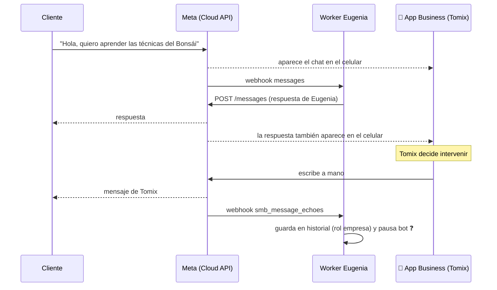

# Coexistencia (WhatsApp Business App + Cloud API)

## Qué es

Hasta 2025, un número que pasaba a la API **dejaba de funcionar en la app** del celular.
Con **coexistencia** (*WhatsApp Business App coexistence*), el mismo número queda
**a la vez**:

- en la app **WhatsApp Business** del celular de Tomix (puede leer y contestar a mano),
- y en la **Cloud API** (Eugenia contesta automáticamente desde el Worker).

Todo lo que entra se ve en los dos lados; lo que manda la API aparece en el celular, y lo
que Tomix manda desde el celular llega al Worker como **eco** (`smb_message_echoes`).

## Cómo se activa (🔵)

1. Requisitos: app WhatsApp Business **v2.24.17 o superior**, el número usándose en la app (idealmente con historial de >7 días), país soportado (Argentina lo está), portfolio comercial.
2. El onboarding se hace con **Embedded Signup** de la app de Meta (o de un proveedor/BSP) eligiendo la opción **"Conectar tu app de WhatsApp Business existente"**.
3. Se escanea un **código QR desde la app** WhatsApp Business del celular (Configuración → Dispositivos vinculados / o el flujo que abre el propio signup).
4. Se elige si **compartir el historial** de chats (hasta **6 meses / 180 días**). Hay **24 h** para que la app sincronice contactos e historial; la app tiene que quedar abierta y con conexión.
5. Al terminar, el número tiene **WABA_ID** y **PHONE_NUMBER_ID** como cualquier número de API.
6. Suscribir la app a la WABA (`/subscribed_apps`) y suscribir los campos de webhook.

## Webhooks propios de coexistencia (🔵)

| Campo | Cuándo llega | Qué debe hacer el Worker |
|---|---|---|
| `messages` | Mensaje entrante de un cliente y **estados** (sent/delivered/read/failed) | Responder (Eugenia) / registrar estado |
| `smb_message_echoes` | Tomix **mandó un mensaje desde la app del celular** | Guardarlo en el historial como mensaje "de la empresa" y, ❓ probablemente, **pausar a Eugenia** en esa charla (intervención humana). **Nunca** tratarlo como mensaje entrante (si no, Eugenia se contesta a sí misma) |
| `history` | Una vez, después del onboarding: chats viejos | Importar al historial de R2 (opcional) |
| `smb_app_state_sync` | Contactos de la app (altas / cambios) | Opcional: nombres de contactos |

Los ecos **no abren ni extienden** la ventana de 24 h de atención al cliente, y no se cobran.
Deduplicar por `id` de mensaje.

## Limitaciones a tener en cuenta (🔵)

- Throughput fijo de **20 mensajes/segundo**.
- No se sincronizan/soportan por API: grupos, listas de difusión, estados, llamadas, mensajes temporales, "ver una vez", ediciones/borrados.
- La app del celular **tiene que abrirse al menos cada ~14 días**, si no Meta puede desvincular la coexistencia.
- Los dispositivos acompañantes no soportados (algunos WhatsApp Web/Desktop) pueden no generar eco.

## Cómo encaja con Eugenia

> [!tip] Ventaja clave
> Tomix sigue viendo y contestando desde su celular como siempre, y la mensajería de la
> API llega a los mismos chats. Por eso las alertas al dueño ([[44 - Pipeline - Alertas al dueño por WhatsApp]])
> pueden salir *desde el número del negocio* hacia el WhatsApp personal de Tomix.
