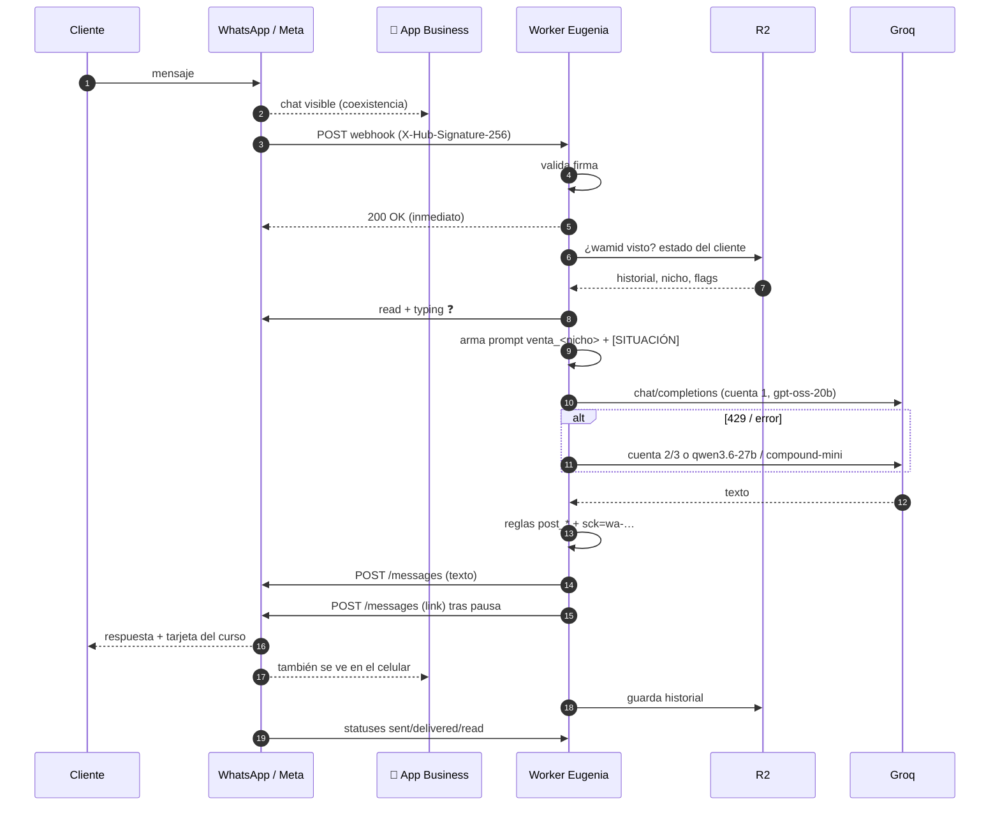

# Pipeline segundo a segundo — de que alguien escribe a que Eugenia contesta

> Los tiempos son **típicos** (🔵): dependen de la red, de Meta y de la carga de Groq.
> Cada paso indica su nivel de certeza (ver [[02 - Fuentes y nivel de certeza]]).

## Línea de tiempo resumida

| t (aprox.) | Dónde | Qué pasa |
|---|---|---|
| **0,0 s** | Celular del cliente | Toca "Enviar" |
| 0,1–0,5 s | Servidores de WhatsApp | Recibe, cifra/entrega al número del negocio |
| 0,3–1 s | 📱 App Business de Tomix | El chat aparece en su celular (coexistencia) |
| 0,5–2 s | Meta → Cloudflare | `POST` del webhook `messages` al Worker |
| +5–30 ms | Worker | Valida firma, deduplica, responde **200** y sigue en segundo plano |
| +20–80 ms | Worker ↔ R2 | Lee estado del cliente / historial |
| +50–150 ms | Worker → Meta | Marca como leído (✔✔ azul) + indicador "escribiendo…" ❓ |
| +0,5–4 s | Worker ↔ Groq | Genera la respuesta (cascada de cuentas/modelos) |
| +1–5 ms | Worker | Reglas post-proceso |
| (+1–3 s) | Worker | Pausa deliberada antes del link (`post_pausa_link`) 🟡 |
| +150–400 ms | Worker → Meta | `POST /{phone_id}/messages` (1 o 2 envíos) |
| +0,3–1 s | Meta → cliente | Llega el mensaje; preview del link se arma en el celular |
| +20–80 ms | Worker → R2 | Guarda historial y estado |
| +1–60 s | Meta → Worker | Webhooks de estado `sent` → `delivered` → `read` |
| **≈ 2–8 s** | | **Total percibido por el cliente** |

---

## Paso 0 — Antes de que escriba: cómo llegó hasta el chat

El cliente casi siempre llega por una de estas puertas ✅:

1. **Anuncio Click-to-WhatsApp** con mensaje precargado ("Hola, quiero aprender las técnicas del Bonsái") → [[41 - Pipeline - Lead desde anuncio Click-to-WhatsApp]].
2. **Botón "Enviar mensaje de WhatsApp"** en cada reel de Facebook (`WHATSAPP_CTA`) → [[45 - Pipeline - Reels con botón de WhatsApp]].
3. **Link `wa.me/5492944508833`** en el copy de los reels / descripción de YouTube.
4. Respuesta a un DM de Instagram ([[42 - Pipeline - Comentario en Instagram a mensaje privado]]) o a un mail de carrito ([[43 - Pipeline - Carritos abandonados]]).

## Paso 1 — t = 0 s · El cliente envía

WhatsApp le pone al mensaje un ID global `wamid.…`. Al llegar al número del negocio se
**abre (o renueva) la ventana de atención de 24 h**: durante 24 h desde este mensaje, el
negocio puede contestar con texto libre y **sin costo** (conversación de servicio). 🔵

## Paso 2 — t ≈ 0,3–1 s · Aparece en el celular de Tomix (coexistencia)

Como el número está en coexistencia, el chat se muestra también en la app WhatsApp
Business. Tomix lo ve en tiempo real pero **no tiene que hacer nada**. → [[13 - Coexistencia]] 🔵

## Paso 3 — t ≈ 0,5–2 s · Meta dispara el webhook

Meta busca qué apps están suscritas a la WABA (`/subscribed_apps`) y hace un `POST` HTTPS a
la URL de callback configurada en la app (→ [[11 - Meta - App Kontrol]]), es decir, al Worker
`marketing-ig-scheduler`. Cuerpo: ver [[14 - Webhooks de WhatsApp#2. Mensaje entrante de texto]]. 🔵/🟡

Cabecera clave: `X-Hub-Signature-256: sha256=…` (HMAC del cuerpo con el **App Secret**).

## Paso 4 — +5–30 ms · El Worker recibe, valida y responde 200

1. Lee el cuerpo **crudo** (`await request.text()`).
2. Calcula HMAC-SHA256 con `META_APP_SECRET` (Web Crypto) y compara con la cabecera → si no coincide, 401.
3. Parsea el JSON y recorre `entry[].changes[]`.
4. **Responde 200 inmediatamente** y pasa el trabajo pesado a `ctx.waitUntil(...)`. Si tardara, Meta reintentaría y Eugenia contestaría dos veces.

🔵 (patrón obligatorio de la Cloud API; implementación de referencia en [[61 - Código de referencia - Worker WhatsApp]]).

## Paso 5 — Clasificar el evento

| `field` / contenido | Acción |
|---|---|
| `messages` con `statuses[]` | Registrar estado. Si `failed` (p. ej. **131047**, fuera de ventana) → anotar y alertar ✅ (`notify.py:232-237`) |
| `messages` con `messages[]` | Seguir al paso 6 |
| `smb_message_echoes` | Tomix escribió desde el celular → guardar como rol "humano" y **no** responder; ❓ pausar a Eugenia en esa charla |
| `history`, `smb_app_state_sync` | Importar / ignorar |

**Deduplicación**: si el `wamid` ya fue procesado (guardado en R2), se descarta. 🔵

**¿Es el dueño?** Si `from` es el número de Tomix → [[33 - Eugenia - Modo dueño]]. ✅ (existe el modo) / 🟡 (cómo se detecta)

## Paso 6 — Decidir el nicho de la charla

Un solo número, dos productos. Orden de decisión 🟡/🔵:

1. Si el cliente **ya existe** en `wa/clientes.json` → su nicho guardado ✅ (archivo existe).
2. Si viene `referral` de un anuncio → nicho del anuncio (`source_id` / `headline`).
3. Si el texto dice "bonsái/árbol" o "hidroponía/cultivo/lechuga…" → por palabras clave (el texto precargado del anuncio ya lo trae).
4. Si no se puede saber → pregunta concreta o nicho por defecto (`hidroponia`, que es el `NICHE` default del sistema ✅ `config.py:501`).

## Paso 7 — Cargar estado desde R2 (+20–80 ms)

`env.R2.get("wa/…")` → historial, si ya se mandó precio/link, ángulos usados, país,
si está pausado por intervención humana, origen (`sck`). ✅ (`wa/clientes.json`) / ❓ (estructura).

## Paso 8 — "Leído" y "escribiendo…" (+50–150 ms) 🔵 ❓

```json
POST /{PHONE_ID}/messages
{"messaging_product":"whatsapp","status":"read","message_id":"wamid…",
 "typing_indicator":{"type":"text"}}
```
El cliente ve los dos tildes azules y "escribiendo…" (dura hasta 25 s o hasta que llegue la respuesta).
Hace que la demora del LLM se perciba humana. (No confirmado que tu Worker lo haga.)

## Paso 9 — Armar el prompt (+1–5 ms) 🟡

1. Toma `prompts/venta_<nicho>.txt` (copia en el Worker / R2; se edita en el panel).
2. Reemplaza `{{PRECIO}}`, `{{QUE_INCLUYE}}`, `{{DATOS_COBRO}}`.
3. Agrega contexto: **precio en la moneda local** del cliente (bloque `[PRECIO — REGLA ABSOLUTA]`, ✅ nombrado en `venta_hidroponia.txt` del 10/11; en bonsái regla `ctx_precio_pais`), **hora local** del cliente (por prefijo de país del `wa_id`: 52 México, 57 Colombia, 51 Perú, 58 Venezuela, 54 Argentina…), país, si es primer mensaje.
4. Agrega `[SITUACIÓN]` según el estado (p. ej. "dijo que está caro → mencionar el {descuento}% una sola vez"; "Argentina quiere pagar → ofrecer transferencia con ALIAS/CBU/BANCO/MONTO"; "Venezuela → Western Union").
5. Agrega el catálogo de otros cursos.
6. Arma `messages = [system, …historial (últimos N turnos), user]`.

## Paso 10 — Generar con Groq (+0,5–4 s)

`POST https://api.groq.com/openai/v1/chat/completions` con `model: openai/gpt-oss-20b`,
`temperature: 0.7`, `max_tokens: 700` ✅ (`parametros_ia.json`). Si hay 429/5xx → siguiente
cuenta (3) y/o siguiente modelo (`qwen/qwen3.6-27b`, `groq/compound-mini`). 🟡

## Paso 11 — Reglas post-proceso (+1–5 ms)

Ver [[32 - Eugenia - Reglas post-proceso]]: formato plano, precio exacto, link en su renglón,
link solo cuando corresponde, bloque de transferencia completo, separar CTA, pausa antes del link.

Al link de compra se le agrega el **origen** `sck=wa-…` (✅ `config.sck("wa", "segui") -> "wa-segui"`),
así Hotmart informa que la venta vino de WhatsApp (solo si el link es de `hotmart.com`).

## Paso 12 — Enviar (+150–400 ms por mensaje)

```json
POST https://graph.facebook.com/v21.0/{WHATSAPP_PHONE_ID}/messages
Authorization: Bearer {WHATSAPP_TOKEN}
{"messaging_product":"whatsapp","recipient_type":"individual","to":"5215512345678",
 "type":"text","text":{"preview_url":true,"body":"…texto de Eugenia…\n\nhttps://pay.hotmart.com/…&sck=wa-…"}}
```
✅ mismo formato que `notify.py:165-170` (allí con `preview_url: false`).
Respuesta: `{"messages":[{"id":"wamid.…"}]}`. **Un 200 no garantiza la entrega** (✅ `notify.py:232`).

Con `post_pausa_link`: primero el texto, espera 1–3 s, después el link solo → la **tarjeta con
imagen del curso** se ve limpia.

## Paso 13 — Guardar (+20–80 ms)

Se agrega el turno al historial en R2, se marca `link_enviado`, ángulo usado, timestamps. 🟡

## Paso 14 — Estados (segundos a minutos después)

Llegan webhooks `sent`, `delivered`, `read` (o `failed`). Sirven para el **embudo** del panel
(`EMBUDO_TZ` ✅) y para detectar mensajes que no salieron. 🟡

## Paso 15 — Lo que pasa si el cliente compra

Hotmart → webhook de compra al Worker (validado con `HOTMART_HOTTOK`) ✅ claves → el Worker puede
marcar al cliente como comprador y dejar de venderle; si pide el acceso, Eugenia **verifica la compra
en Hotmart antes de reenviar accesos** ✅ (`config.py:645-647`). La venta queda atribuida por `sck`.

---

## Diagrama de secuencia completo


