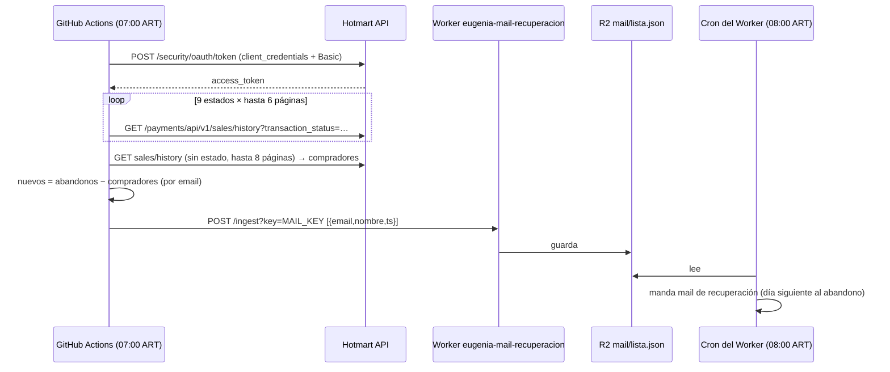

# Pipeline — Carritos abandonados (todo ✅, repo `eugenia-carritos`)

## Detalle segundo a segundo

| Hora ART | Qué |
|---|---|
| 07:00 | Cron `0 10 * * *` (UTC) del workflow `carritos.yml` arranca un `ubuntu-latest` |
| +20 s | Python 3.11 + `pip install requests` |
| +25 s | Token OAuth en `https://api-sec-vlc.hotmart.com/security/oauth/token` |
| +30–90 s | Ventana de **7 días** (`DIAS`), estados `STARTED, PRINTED_BILLET, WAITING_PAYMENT, EXPIRED, NO_FUNDS, OVERDUE, CANCELLED, BLOCKED, UNDER_ANALISYS`, 100 por página |
| | Por email se queda con el intento más reciente y su nombre |
| | Excluye a quien sí compró (cualquier venta en la ventana) |
| | Si no hay nuevos: "nada nuevo -> no mando nada." |
| +~1 min | `POST {WORKER_URL}/ingest?key={MAIL_KEY}` con la lista; `raise_for_status()` |
| 08:00 | Cron del Worker manda los mails |

## Relación con WhatsApp

Es un canal **paralelo** (mail): el carrito de Hotmart no siempre trae teléfono y
escribirle a alguien por WhatsApp sin que haya escrito primero exige **plantilla aprobada**
(categoría *marketing*, con costo) y consentimiento. 🔵 Si un día se agrega, ver [[71 - Seguridad y cumplimiento]].
