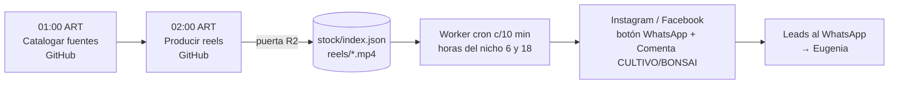

# Pipeline — Producción y publicación de reels (contexto)

No es WhatsApp, pero es **lo que genera los leads** que llegan al WhatsApp y comparte
Worker, R2 y tokens. Resumen (✅ `eugenia-produccion`):

| Paso | Detalle |
|---|---|
| Fuentes | Videos de TikTok catalogados (`fuentes_nube.py`, `catalogar_fuente.py`); Gemini revisa |
| Producción | `produccion_nube.py`: 3 por día y nicho hasta 20 en stock; voz Antonio (ElevenLabs, 5 cuentas) → Charon (Google) → voz gratis; subtítulos karaoke; logo y mockup |
| Copy | Gemini + bloque de oferta fijo + "💬 Comenta CULTIVO/BONSAI y te mando el link por privado 📩" |
| Stock | `armar_stock.agregar()` sube `reels/<id>.mp4` + fila en `stock/index.json` |
| Publicación | Worker: a las horas de `state/toggles.json` (default 6 y 18 ART) si `encolado` está prendido; o la PC con `publisher.publicar_reel` (FB con botón WA, IG directo o encolado, YouTube) |
| Aviso | `notify.whatsapp` → WhatsApp de Tomix |
| Reparto (02/11) | `produccion_nube.repartir`: los cupos del día van primero al nicho con **menos** stock, máx. 5 por nicho y hasta 20 en stock |
| Voz y subtítulos (02–04/11) | Se eliminó la prueba A/B (sistema A/B). Subtítulos estilo "viral #1": 1 palabra por pantalla, Baloo 2 ExtraBold 234 px, color `00EEFF`, minúsculas. Sincronía por palabra con **Whisper de Cloudflare** (`/whisper` de la puerta) |
| Ajustes del panel → nube | `state/nichos/<nicho>.yaml` + bóveda cifrada (`panel/boveda_produccion.json`) |
| YouTube (02/11) | `subir_youtube_nube.py` al final del workflow: sube lo que el Worker anotó en `stock/publicados.json`, solo nichos con `yt` prendido y canal conectado, máx. por corrida por cupo de YouTube |
| Idempotencia | registro con `parcial=True` antes de publicar; `intentos` por plataforma |
