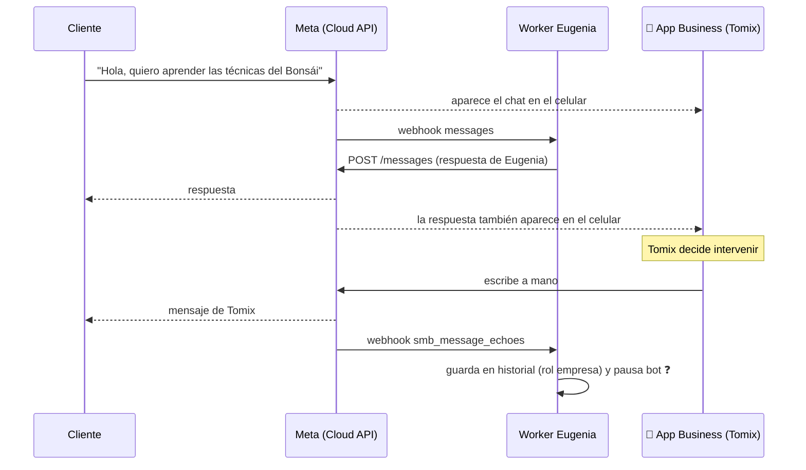
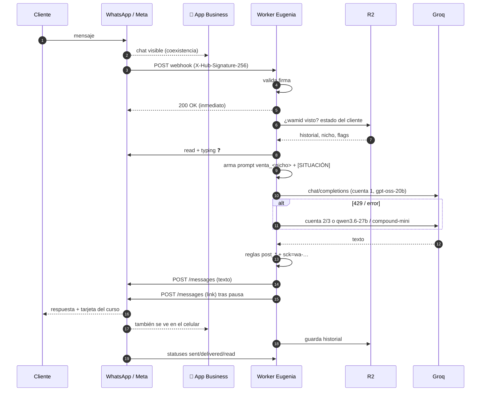
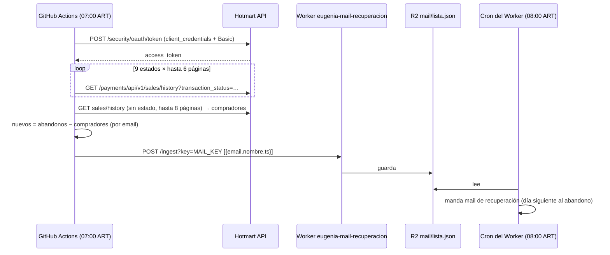
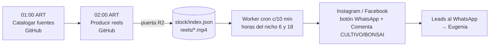

# Whapi — Documento completo

> Todas las notas del vault en un solo archivo. Generado el 04/11/2026. Fuente canónica: tomixrecoil/eugenia-carritos/Whapi.


---

<!-- 00 - Inicio.md -->
# Whapi — WhatsApp automatizado de Eugenia

> Documentación completa de cómo funciona el WhatsApp **+54 9 294 450-8833** del negocio
> (Ecosistema Hidropónico / Bonsái en Casa), atendido automáticamente por **Eugenia**:
> desde la app de Meta Developers **Kontrol**, pasando por la **WhatsApp Cloud API en
> coexistencia** con la app WhatsApp Business, los **Workers de Cloudflare** y **R2**,
> hasta el panel web y la PC.

Si es la primera vez que entrás, leé en este orden:

0. [[03 - Contexto para Claude]] — **resumen condensado de todo Whapi** (lo que cualquier Claude lee primero).
1. [[01 - Mapa general]] — el dibujo completo en una página.
2. [[02 - Fuentes y nivel de certeza]] — **qué está verificado en código y qué no** (leer sí o sí).
3. [[40 - Pipeline segundo a segundo - mensaje entrante]] — el corazón: qué pasa desde que alguien escribe hasta que Eugenia contesta.
4. [[60 - Replicar desde cero]] — la receta para armarlo de nuevo en otra cuenta.

---

## Mapa de notas

### Meta (Facebook / WhatsApp)
- [[10 - Meta - Business Manager, WABA y número]]
- [[11 - Meta - App Kontrol]]
- [[12 - Meta - Tokens y permisos]]
- [[13 - Coexistencia]]
- [[14 - Webhooks de WhatsApp]]

### Cloudflare
- [[20 - Cloudflare - Cuenta, Workers y R2]]
- [[21 - Worker marketing-ig-scheduler (Eugenia)]]
- [[22 - Worker eugenia-mail-recuperacion]]
- [[23 - Worker eugenia-puerta-r2]]
- [[24 - R2 - Mapa de claves]]
- [[25 - Secretos y variables]]

### Eugenia (el cerebro)
- [[30 - Eugenia - Cerebro y modelos]]
- [[31 - Eugenia - Prompt de venta]]
- [[32 - Eugenia - Reglas post-proceso]]
- [[33 - Eugenia - Modo dueño]]
- [[34 - Eugenia - Voz y notas de voz]]

### Pipelines (flujos de punta a punta)
- [[40 - Pipeline segundo a segundo - mensaje entrante]]
- [[41 - Pipeline - Lead desde anuncio Click-to-WhatsApp]]
- [[42 - Pipeline - Comentario en Instagram a mensaje privado]]
- [[43 - Pipeline - Carritos abandonados]]
- [[44 - Pipeline - Alertas al dueño por WhatsApp]]
- [[45 - Pipeline - Reels con botón de WhatsApp]]
- [[46 - Pipeline - Producción y publicación de reels]]

### Frontend, backend y automatizaciones
- [[50 - Frontend - Panel web]]
- [[51 - Backend - PC marketing-agent]]
- [[52 - GitHub Actions]]

### Replicar, operar, arreglar
- [[60 - Replicar desde cero]]
- [[61 - Código de referencia - Worker WhatsApp]]
- [[62 - Checklist de pruebas]]
- [[70 - Errores conocidos y troubleshooting]]
- [[71 - Seguridad y cumplimiento]]
- [[80 - Cronograma del día]]
- [[90 - Glosario]]
- [[98 - Bitácora]]
- [[99 - Pendientes de documentar]]

---

## Datos clave de un vistazo

| Qué | Valor |
|---|---|
| Número de WhatsApp | `+54 9 294 450-8833` (`5492944508833`, Bariloche, AR) |
| Link público | `https://wa.me/5492944508833` |
| Asistente | **Eugenia** ("Eugenia es mi nombre" / "Euge es mi nombre") |
| Negocios / productos | *Ecosistema Hidropónico* → Curso Completo de Hidroponía · *Bonsái en Casa* → Bonsai en casa desde cero (antes «El Arte del Bonsái») |
| Business Manager | `450083674862372` |
| Página FB hidroponía | `615394648318530` |
| Página FB bonsái | `620810857774404` |
| API | WhatsApp **Cloud API** (Graph `v21.0` por defecto) en **coexistencia** con WhatsApp Business App |
| App de Meta | **Kontrol** (token de sistema `META_TOKEN_KONTROL`, creado 29/08/2026) |
| Worker principal | `marketing-ig-scheduler.goldentimeshift.workers.dev` |
| Otros Workers | `eugenia-mail-recuperacion`, `eugenia-puerta-r2` |
| Bucket R2 | `marketing-reels` |
| LLM de las charlas | **Groq** (3 cuentas, 3 modelos en cascada) |
| Venta | Hotmart (checkout `W99083833C` hidroponía, `T97313346W` bonsái) |
| Copia canónica del vault | `tomixrecoil/eugenia-carritos` → `Whapi/` |


---

<!-- 01 - Mapa general.md -->
# Mapa general de la arquitectura

## En una frase

Una persona le escribe al **+54 9 294 450-8833** → los servidores de Meta (WhatsApp
**Cloud API**, número en **coexistencia** con la app WhatsApp Business del celular) le
mandan un **webhook** a la app de Meta (**Kontrol**) → ese webhook apunta a un **Worker de
Cloudflare** → el Worker carga la conversación desde **R2**, arma el *prompt* de venta de
**Eugenia**, le pregunta a **Groq** (LLM), limpia la respuesta con las **reglas** →
la manda con `POST /{phone-number-id}/messages` → el mensaje aparece en el WhatsApp del
cliente **y también** en la app WhatsApp Business del celular de Tomix.

## Diagrama

```mermaid
flowchart LR
  subgraph Cliente
    U[📱 Lead / cliente]
  end
  subgraph Meta
    WA[(WhatsApp\nCloud API)]
    APP[App Meta Developers\n«Kontrol»\nwebhooks + tokens]
    BIZ[📱 WhatsApp Business App\ncelular de Tomix\n(coexistencia)]
    ADS[Anuncios Click-to-WhatsApp\n+ botón WA en reels]
    IG[Instagram / Facebook]
  end
  subgraph Cloudflare
    W1[Worker\nmarketing-ig-scheduler\n= Eugenia]
    W2[Worker\neugenia-mail-recuperacion]
    W3[Worker\neugenia-puerta-r2]
    R2[(R2 bucket\nmarketing-reels)]
    CRON1((cron c/10 min))
    CRON2((cron 8 am ART))
  end
  subgraph IA
    GROQ[Groq\ngpt-oss-20b → qwen3.6-27b → compound-mini]
    GEM[Gemini\n(reels / copys)]
  end
  subgraph PC[PC Windows «MYX» — marketing-agent]
    PANEL[Panel web\nwebapp.py]
    TAREAS[Tareas programadas\nmonitor ventas, vigilancia]
    WR[wrangler CLI]
  end
  subgraph GitHub
    GH1[Actions: Producir reels 02:00]
    GH2[Actions: Catalogar fuentes 01:00]
    GH3[Actions: Carritos 07:00]
  end
  HOT[Hotmart]

  U -- escribe --> WA
  ADS -- abre chat --> U
  WA -- webhook POST --> APP --> W1
  W1 <--> R2
  W1 -- prompt --> GROQ
  W1 -- POST /messages --> WA --> U
  WA <-. sync / echoes .-> BIZ
  BIZ -- Tomix contesta a mano --> WA
  IG -- webhook comentario --> W1
  W1 -- DM con link --> IG
  CRON1 --> W1
  W1 -- publica reels IG/FB --> IG
  HOT -- webhook venta (hottok) --> W1
  GH3 -- POST /ingest --> W2 --> R2
  CRON2 --> W2
  GH1 & GH2 -- x-clave --> W3 --> R2
  PANEL -- PANEL_KEY --> W1
  WR --> R2
  TAREAS -- alertas Cloud API --> WA
```

## Las piezas y su rol

| Pieza | Rol | Nota |
|---|---|---|
| Número `+5492944508833` | Línea única de atención y ventas para los dos productos | [[10 - Meta - Business Manager, WABA y número]] |
| WhatsApp Business App (celular) | Sigue funcionando en paralelo: Tomix ve todo y puede intervenir | [[13 - Coexistencia]] |
| WABA + Cloud API | La "puerta programática" del número | [[10 - Meta - Business Manager, WABA y número]] |
| App **Kontrol** (Meta for Developers) | Contenedor de permisos, webhooks y token de sistema | [[11 - Meta - App Kontrol]] |
| Worker `marketing-ig-scheduler` | El backend de Eugenia: webhook WA, IG, Hotmart, cron de publicación, endpoints del panel | [[21 - Worker marketing-ig-scheduler (Eugenia)]] |
| R2 `marketing-reels` | La "base de datos": clientes, conversaciones, colas, stock, toggles | [[24 - R2 - Mapa de claves]] |
| Groq | Genera cada respuesta de Eugenia | [[30 - Eugenia - Cerebro y modelos]] |
| Prompts `venta_<nicho>.txt` | Personalidad, producto, método de venta, reglas duras | [[31 - Eugenia - Prompt de venta]] |
| Reglas post-proceso | Arreglan la respuesta antes de mandarla (link, precio, formato) | [[32 - Eugenia - Reglas post-proceso]] |
| Panel web (PC) | Editar prompts, reglas, nichos, credenciales; ver embudo, salud, ventas | [[50 - Frontend - Panel web]] |
| GitHub Actions | Producción de reels y carritos abandonados con la PC apagada | [[52 - GitHub Actions]] |
| Hotmart | Cobro, webhooks de venta, carritos abandonados | [[43 - Pipeline - Carritos abandonados]] |

## Principios de diseño que se repiten en todo el sistema

1. **Que funcione con la PC apagada.** Todo lo que atiende clientes vive en Cloudflare; la PC solo edita y produce. ✅ (`armar_stock.py`, `r2io.py`, `README` de carritos)
2. **R2 es la fuente de verdad**, no el disco. ✅ (`registro_fuentes.py:48`, `toggles.py`)
3. **Una sola fuente por dato**: el link de venta sale de `config.checkout()`; los nichos activos de `nichos_produccion()`. ✅
4. **Cada link de venta lleva su origen** (`sck=wa-…`, `ig-r-…`, `fb-r-…`) para saber qué canal vendió. ✅ (`config.sck`)
5. **Mínimo privilegio**: la nube (GitHub) nunca ve `wa/clientes.json`; pasa por la "puerta". ✅ (`r2io.py`)
6. **Nunca mentir en precio ni urgencia**; Eugenia no inventa descuentos ni cupos. ✅ (prompts)


---

<!-- 02 - Fuentes y nivel de certeza.md -->
# Fuentes y nivel de certeza

Esta documentación se armó leyendo **todo** el código de los tres repositorios que hay en
GitHub (`eugenia-produccion`, `eugenia-carritos`, `sylvana-jarvis`) al 01/11/2026, y se actualizó con el
export nuevo de `eugenia-produccion` del 04/11/2026 (commits `167545e` y `7c00018`).

> [!warning] Lo que NO estaba disponible
> El código fuente del **Worker de Cloudflare que atiende WhatsApp** (carpeta
> `marketing-agent/cloudflare-worker/`), el **panel web** (`webapp.py`) y el resto de
> `marketing-agent` **viven solo en la PC Windows "MYX"** y no están subidos a GitHub.
> `eugenia-produccion` es una *copia parcial* de `marketing-agent` (lo dice su README).
> Por eso, todo lo que pasa *dentro* del Worker se reconstruyó a partir de:
> - comentarios y llamadas en el código Python que habla con el Worker,
> - los prompts de venta de Eugenia (`prompts/venta_*.txt`), que son lo que el Worker le manda al modelo,
> - las claves de R2 y endpoints que el código nombra,
> - y el funcionamiento oficial de la WhatsApp Cloud API / Cloudflare Workers.
>
> Ver [[99 - Pendientes de documentar]] para cerrar esos huecos.

## Leyenda (se usa en todas las notas)

| Marca | Significa |
|---|---|
| ✅ **Verificado** | Está escrito en el código o la config de los repos. Se cita archivo y línea. |
| 🟡 **Deducido** | Lo afirma un comentario del código o se desprende sin dudas de él, pero el código que lo ejecuta no está en los repos. |
| 🔵 **Estándar** | Así funciona la plataforma (Meta / Cloudflare / Groq / Hotmart). Es como *hay que* hacerlo para replicar; el detalle exacto de tu implementación puede variar. |
| ❓ **Sin confirmar** | Hipótesis razonable. Verificar en la PC antes de confiar. |

## Archivos que aportaron evidencia

| Archivo | Qué aporta |
|---|---|
| `eugenia-produccion/config.py` | Lista completa de secretos (`ENV_KEYS`), token de sistema, app **Kontrol**, Groq, hottok, `PANEL_KEY`, `sck()` (origen `wa-…`), derivación de tokens de página |
| `eugenia-produccion/prompts/venta_hidroponia.txt` · `venta_bonsai.txt` | El *system prompt* de Eugenia en WhatsApp, con sus placeholders `{{PRECIO}}`, `{{QUE_INCLUYE}}`, `{{DATOS_COBRO}}`, `[SITUACIÓN]` |
| `eugenia-produccion/prompts/*_reglas.json` | Los interruptores de las reglas de post-proceso de las respuestas |
| `eugenia-produccion/prompts/bonsai_incluye_ar.txt` / `bonsai_producto.md` | El texto fijo "QUÉ INCLUYE" |
| `eugenia-produccion/parametros_ia.json` | Modelos y temperatura de Groq y Gemini |
| `eugenia-produccion/src/notify.py` | Envío real de WhatsApp por Cloud API (`/{phone_id}/messages`), ventana de 24 h, error 131047 |
| `eugenia-produccion/src/publish.py` / `src/publisher.py` | Botón "Enviar mensaje de WhatsApp" en los reels, cola de Instagram en R2, cron del Worker cada 10 min |
| `eugenia-produccion/src/toggles.py` | `state/toggles.json` que lee el Worker (encolado y horarios) |
| `eugenia-produccion/armar_stock.py` | URL del Worker, ruta pública `/v/`, guard contra `wa/clientes.json`, órdenes del dueño a Eugenia |
| `eugenia-produccion/r2io.py` | Worker `eugenia-puerta-r2` (cabecera `x-clave`) |
| `eugenia-produccion/registro_fuentes.py` | "Eugenia tiene que poder consultar el registro desde WhatsApp" |
| `eugenia-produccion/producir_stock.py` | Comentar CULTIVO/BONSAI → link por privado (lo hace el Worker) |
| `eugenia-produccion/src/pipeline.py` | XTTS local = voz de Eugenia (clon de Sylvana) |
| `eugenia-carritos/*` | Worker `eugenia-mail-recuperacion`, `/ingest`, cron 8 am |
| `eugenia-produccion/r2io.py` (04/11) | Bóveda cifrada `panel/boveda_produccion.json`, `state/nichos/*.yaml` |
| `eugenia-produccion/subir_youtube_nube.py` (04/11) | `stock/publicados.json` lo anota el Worker; `stock/youtube.json`; interruptor `yt` |
| `eugenia-produccion/src/toggles.py` (04/11) | Interruptores `fb`/`ig`/`yt`; nombre real de la función del Worker: `publicarDeStock` |
| `eugenia-produccion/src/voz_charon.py` (04/11) | Ruta `/whisper` de la puerta R2 (Whisper de Cloudflare) |
| `sylvana-jarvis/*` | **No participa** del WhatsApp (asistente de voz / trading). Solo lo nombra como integración futura en el PRD. |


---

<!-- 03 - Contexto para Claude.md -->
# Contexto para Claude — Whapi en una página

> **Whapi es el proyecto más importante de Tomix.** Cualquier Claude (Code, VS Code,
> Chrome, navegador, claude.ai) que trabaje con él tiene que leer esta nota primero.
> **Fuente canónica: repo `tomixrecoil/eugenia-carritos`, carpeta `Whapi/`** (vault de
> Obsidian; ese repo no se regenera). Copias: `eugenia-produccion/Whapi/` (se borra cada vez
> que corre `exportar_produccion.py`: volver a copiarla), `sylvana-jarvis/docs/Whapi/`,
> Notion ([página Whapi](https://app.notion.com/p/40b5314feb14811998b6f2efd27d4640) + memoria
> [Whapi](https://app.notion.com/p/40b5314feb1481b089f9e599a56752a4)) y Google Drive
> ([carpeta Whapi](https://drive.google.com/drive/folders/1PxsigA6ZAx83L9TqKoM9Gs-m4F65mrA0) →
> "Whapi - Resumen, pipeline y guía para replicar"). En cada repo: `CLAUDE.md` + skill `.claude/skills/whapi/`.

## Qué es

El WhatsApp del negocio **+54 9 294 450-8833** (`5492944508833`, Bariloche) atendido
automáticamente por **Eugenia**, asesora de ventas con nombre humano, para dos productos:

| Nicho | Negocio | Producto | Checkout Hotmart | Página FB |
|---|---|---|---|---|
| `hidroponia` | Ecosistema Hidropónico | Curso Completo de Hidroponía (+32 h) | `W99083833C` | `615394648318530` |
| `bonsai` | Bonsái en Casa | Bonsai en casa desde cero (antes «El Arte del Bonsái»; +6 h, 3 cursos en 1) | `T97313346W` (landing `conocimientosdigital.com/bonsai/`) | `620810857774404` |

Portfolio comercial (Business Manager): `450083674862372`. Descuento por nicho: 80 % (solo si dicen "caro").

## Arquitectura (de memoria)

```
Cliente → WhatsApp Cloud API (número en COEXISTENCIA con la app WhatsApp Business del celular de Tomix)
       → webhook de la app de Meta (Kontrol u otra) → Worker Cloudflare marketing-ig-scheduler (= Eugenia)
       → R2 marketing-reels (wa/clientes.json, historial) → prompt venta_<nicho>.txt + [SITUACIÓN]
       → Groq (gpt-oss-20b → qwen3.6-27b → compound-mini; 3 cuentas; temp 0.7; 700 tokens)
       → reglas post_* (formato, precio exacto, link aparte, sck=wa-…) → POST /{phone_id}/messages
```

- **Workers** (`*.goldentimeshift.workers.dev`): `marketing-ig-scheduler` (Eugenia + cron c/10 min de publicación IG + `/v/` videos + `/wa-groq?listar=1` + webhooks IG/Hotmart + endpoints con `PANEL_KEY`), `eugenia-mail-recuperacion` (`/ingest` + cron 8 am, carritos), `eugenia-puerta-r2` (acceso limitado a R2 para GitHub, cabecera `x-clave`).
- **R2 `marketing-reels`**: `wa/…` (sensible), `queue/<fecha>.json`, `reels/<id>.mp4`, `stock/index.json`, `state/toggles.json`, `fuentes/usadas.json`, `mail/lista.json`.
- **App Meta «Kontrol»**: token de sistema `META_TOKEN_KONTROL` (29/08/2026) con permisos amplios; es **respaldo**, NO reemplaza a `WHATSAPP_TOKEN` sin confirmación de Tomix.
- **Tokens**: `WHATSAPP_TOKEN` = usuario de sistema, no vence, también deriva page tokens (`config.token_de_pagina`). `WHATSAPP_PHONE_ID`, `WHATSAPP_WABA_ID`, `META_APP_SECRET`.
- **Bóveda de credenciales** (02/11/2026): `panel/boveda_produccion.json` en R2, cifrada AES-GCM; GitHub la abre con `BOVEDA_PRODUCCION_KEY` (`r2io.cargar_credenciales`). Los ajustes de nicho del panel viajan a `state/nichos/<nicho>.yaml`.
- **Interruptores por nicho** en `state/toggles.json`: `produccion`, `encolado`, `fb`, `ig`, `yt`, `horas`. El Worker (`publicarDeStock`) los respeta y anota lo publicado en `stock/publicados.json`.
- **PC Windows "MYX"**: `marketing-agent/` (código real del Worker en `cloudflare-worker/`, panel `webapp.py`, `.env`). **No está en GitHub.**
- **GitHub Actions**: 01:00 catalogar fuentes, 02:00 producir reels, 07:00 carritos (ART).
- **Coexistencia**: Tomix ve y contesta desde el celular; sus mensajes llegan como `smb_message_echoes`. La app debe abrirse cada ≤14 días. 20 msg/s.
- **Alertas** al dueño: `notify.py` → Cloud API a `ALERT_WHATSAPP`; si no le escribió al número en 24 h, error 131047 llega por webhook aunque el POST dé 200.

## Reglas de Eugenia que NUNCA se rompen

- Precio **exacto** con centavos (`{{PRECIO}}` USD, pago único). Sin urgencias, cupos ni "gratis".
- Link solo, en su renglón, al final (para la tarjeta de preview); nunca `[texto](url)`; uno por mensaje.
- Español neutro, sin voseo ni argentinismos; 3–4 líneas, < 500 caracteres; 1–3 emojis; sin negritas.
- Nunca "¿en qué te ayudo?" (57 % vs 73 % con pregunta concreta). Nunca usar un nombre que el cliente no dio.
- No inventar nada fuera de "QUÉ INCLUYE". Hardship genuino → despedida cálida sin link.
- Datos de cobro solo los oficiales (anti-fraude). Venezuela → Western Union. Argentina → transferencia (ALIAS/CBU/BANCO/MONTO, solo si están los 4).

## Cómo trabajar en Whapi (para cualquier Claude)

1. Leer `Whapi/00 - Inicio.md` y la nota que corresponda. Respetar la leyenda ✅/🟡/🔵/❓ de `02 - Fuentes y nivel de certeza.md`.
2. **Todo cambio** al sistema se documenta en el vault en el mismo trabajo (y se actualiza esta nota si cambia algo de arriba). Si algo pasa de ❓ a ✅, cambiar la marca.
3. Nunca escribir valores de secretos en el vault, en commits ni en Notion/Drive: solo nombres.
4. El código de referencia probado está en `Whapi/codigo/worker-referencia` (`npm test`).
5. Huecos abiertos: `99 - Pendientes de documentar.md` (requiere el código de `marketing-agent`).
6. `eugenia-produccion` se regenera con `exportar_produccion.py` (pasó el 04/11/2026 y borró `Whapi/`): editar siempre la copia de `eugenia-carritos` y desde ahí copiar a los demás. Arreglo definitivo pendiente: que `exportar_produccion.py` conserve `Whapi/`, `CLAUDE.md` y `.claude/`.


---

<!-- 10 - Meta - Business Manager, WABA y número.md -->
# Meta — Business Manager, WABA y número

## Jerarquía de objetos en Meta

```
Business Manager (Portfolio comercial)  450083674862372  ✅ niches/*.yaml
├── Páginas de Facebook
│   ├── Ecosistema Hidropónico   615394648318530  ✅ niches/hidroponia.yaml
│   └── Bonsái en Casa           620810857774404  ✅ niches/bonsai.yaml  (producto: «Bonsai en casa desde cero»)
│        (cada una con su Instagram vinculado — publish_ig.get_ig_user_id)
├── Cuenta de WhatsApp Business (WABA)          → WHATSAPP_WABA_ID  ✅ config.py
│   └── Número +54 9 294 450-8833               → WHATSAPP_PHONE_ID ✅ config.py
├── Usuario de sistema (System User)           → genera WHATSAPP_TOKEN / META_TOKEN_KONTROL
├── Cuenta publicitaria                        → AD_ACCOUNT_ID / META_AD_ACCOUNT_ID
└── App de Meta for Developers «Kontrol»       → ver [[11 - Meta - App Kontrol]]
```

## Los tres identificadores de WhatsApp (✅ `config.py:192-194`)

| Variable | Qué es | Para qué se usa |
|---|---|---|
| `WHATSAPP_WABA_ID` | ID de la WhatsApp Business Account | Suscribir la app a los webhooks de la WABA (`POST /{waba-id}/subscribed_apps`), leer plantillas, número, calidad |
| `WHATSAPP_PHONE_ID` | **Phone Number ID** (no es el número: es un ID numérico largo) | Endpoint de envío `POST /{phone-number-id}/messages` y marcar leídos |
| `WHATSAPP_TOKEN` | Token de **usuario de sistema** (no vence) | Autoriza todo lo anterior **y** además llega a las 4 páginas de FB (se deriva el page token de cada una) |

> [!info] Por qué un solo token para todo (✅ `config.py:312-362`)
> `token_de_pagina()` llama a `GET /me/accounts?fields=id,access_token` con
> `WHATSAPP_TOKEN` y guarda el token de cada página en memoria. Así, conectar la página de
> bonsái ya no pisa la de hidroponía, y como el token es de sistema **no vence** (el page
> token "humano" vencía el 02/10/2026 por la regla de 90 días de acceso a datos).

## El número

- **+54 9 294 450-8833** — código de área 294 (San Carlos de Bariloche, Río Negro).
- Formato que espera la API: `5492944508833` (sin `+`, sin espacios). ✅ (`notify.py:154`, "Numero con codigo de pais, sin +")
- Aparece en todos los copys de los reels: `📲 Escríbeme por WhatsApp 👉 https://wa.me/5492944508833` ✅ (`prompts/gpt_copy.txt:134`, `hidroponia_gpt.txt:150`, `bonsai_gpt.txt:134`)
- Está registrado en **coexistencia**: el mismo número sigue abierto en la app WhatsApp Business del celular → [[13 - Coexistencia]].
- Un solo número atiende **dos productos** distintos; el Worker decide de qué nicho es cada charla → [[40 - Pipeline segundo a segundo - mensaje entrante#Paso 6 — Decidir el nicho de la charla]].

## Requisitos de Meta para tener esto (🔵)

1. Portfolio comercial **verificado** (Configuración del negocio → Centro de seguridad → Verificación). Sin verificar: límite de 250 conversaciones iniciadas por la empresa / 24 h y no se puede subir de nivel.
2. Nombre visible del número aprobado (display name).
3. Método de pago cargado en la WABA (las conversaciones de **marketing / utilidad** iniciadas con plantilla se cobran; las respuestas dentro de la ventana de 24 h a quien te escribió —*service*— son gratis).
4. App de Meta con el producto **WhatsApp** agregado → [[11 - Meta - App Kontrol]].

## Calidad y límites (🔵)

- **Calidad del número** (verde / amarillo / rojo) según bloqueos y reportes. Eugenia está diseñada para no ser invasiva (prohibido insistir con hardship genuino, prohibido urgencias falsas) en parte por esto. Ver [[71 - Seguridad y cumplimiento]].
- **Límite de mensajería**: cuántos clientes *nuevos* se pueden contactar por plantilla en 24 h (250 → 1K → 10K → 100K → ilimitado). Responder a quien escribió **no** consume este límite.
- En coexistencia el *throughput* de la API queda fijo en **20 mensajes/segundo**.


---

<!-- 11 - Meta - App Kontrol.md -->
# Meta — App «Kontrol» (Meta for Developers)

## Qué es

Una **app de Meta for Developers** (developers.facebook.com → Mis apps) llamada **Kontrol**.
En Meta, una "app" no es algo que se instala: es el **contenedor de permisos y webhooks**
a través del cual un sistema externo (acá, los Workers y la PC) habla con las APIs de
WhatsApp, Instagram, Páginas y Ads.

✅ Evidencia (`config.py:663-667`):

> *Token de sistema de la app de Meta "Kontrol" (29/08). Permisos amplios (WhatsApp,
> Instagram, Ads, paginas) — candidato fuerte a reemplazar WHATSAPP_TOKEN si ese se cae,
> pero NO se pisa el que ya esta en produccion sin que Tomix lo confirme: lo usan todas
> las conversaciones activas. Guardado aparte hasta que diga para que va.*
> → variable `META_TOKEN_KONTROL`

## Rol de Kontrol en el sistema

| Función | Detalle | Certeza |
|---|---|---|
| Emisor del token de sistema "amplio" | `META_TOKEN_KONTROL`, con WhatsApp + Instagram + Ads + Páginas | ✅ |
| Respaldo del token de producción | Reemplazo previsto de `WHATSAPP_TOKEN` si este se cae; **todavía no en uso** al 01/11/2026 | ✅ |
| Credenciales de app | `META_APP_ID` / `META_APP_SECRET` (`config.py:187-188`) — el *App Secret* firma los webhooks (`X-Hub-Signature-256`) | ✅ claves / 🔵 uso |
| Suscripción de webhooks | Producto WhatsApp → Configuración → URL de callback = Worker + token de verificación; campos `messages` (y en coexistencia `smb_message_echoes`, `history`, `smb_app_state_sync`) | 🔵 |
| Login/Embedded Signup de coexistencia | La app es la que hace el *onboarding* del número en coexistencia | 🔵 |
| Instagram | Webhooks de comentarios para el flujo "Comenta CULTIVO" → [[42 - Pipeline - Comentario en Instagram a mensaje privado]] | 🟡 |

> [!question] ¿Kontrol es la app que hoy recibe los webhooks de WhatsApp?
> El código solo dice que su token es un **respaldo**. El token en producción
> (`WHATSAPP_TOKEN`) es de un usuario de sistema que podría haber sido generado con
> **otra** app. Verificar en developers.facebook.com → Kontrol → WhatsApp → Configuración
> si la URL de callback apunta al Worker. Ver [[99 - Pendientes de documentar]].

## Cómo se crea una app como Kontrol (🔵 paso a paso)

1. developers.facebook.com → **Mis apps → Crear app**.
2. Caso de uso: **Otro** → Tipo: **Empresa (Business)**. Nombre: `Kontrol`. Vincularla al portfolio `450083674862372`.
3. En el panel de la app → **Agregar producto → WhatsApp → Configurar**. Elegir la WABA del negocio.
4. **Configuración de la app → Básica**: copiar **ID de la app** (`META_APP_ID`) y **Clave secreta** (`META_APP_SECRET`). Completar URL de política de privacidad, ícono, categoría.
5. **WhatsApp → Configuración → Webhook**:
   - URL de devolución de llamada: `https://<worker>.workers.dev/<ruta-webhook>`
   - Token de verificación: un string inventado (secreto del Worker, p. ej. `WA_VERIFY_TOKEN`).
   - **Administrar campos** → suscribir `messages`. En coexistencia además `smb_message_echoes`, `history`, `smb_app_state_sync`.
6. (Si hace falta) **Agregar producto → Instagram** (comentarios / mensajes) y **Webhooks → Page** (`feed`) / **Instagram** (`comments`, `messages`).
7. Pasar la app a **modo Activo (Live)**. En modo desarrollo solo llegan webhooks de usuarios con rol en la app.
8. **Revisión de la app**: para `whatsapp_business_messaging`, `whatsapp_business_management`, `instagram_manage_comments`, `instagram_manage_messages`, `pages_manage_posts`, `ads_read`… con **Acceso avanzado** cuando se usan con activos de terceros. Si todos los activos son del mismo portfolio que es dueño de la app, alcanza con acceso estándar + usuario de sistema.
9. Generar el **token de sistema** → [[12 - Meta - Tokens y permisos]].
10. Suscribir la app a la WABA: `POST https://graph.facebook.com/v21.0/{WABA_ID}/subscribed_apps` con el token. (Sin esto la WABA **no** manda webhooks a la app aunque esté todo configurado.)


---

<!-- 12 - Meta - Tokens y permisos.md -->
# Meta — Tokens y permisos

## Inventario de tokens (✅ `config.py`)

| Variable | Tipo | Vence | Lo usa |
|---|---|---|---|
| `WHATSAPP_TOKEN` | Usuario de sistema del negocio | **Nunca** | Worker (enviar/recibir WhatsApp), `notify._enviar_whatsapp`, derivación de *page tokens* (`token_de_pagina`) |
| `META_TOKEN_KONTROL` | Usuario de sistema, app Kontrol | Nunca | Respaldo, no en producción aún |
| `META_PAGE_ACCESS_TOKEN` | Page token nacido de login humano | Acceso a datos a los 90 días (vencía 02/10/2026) | Fallback de publicación si no hay token de sistema |
| `META_ADS_TOKEN` | Token con `ads_read` | según cómo se generó | Panel de gasto de anuncios (`webapp.py`) |
| `META_APP_SECRET` | Secreto de la app | — | Validar firma de webhooks, `appsecret_proof` |

> [!danger] Trampa del token humano (✅ `config.py:327-331`)
> Un token derivado de un login humano "parece válido" después de los 90 días pero las
> respuestas vuelven **vacías**. Falla como si todo estuviera roto sin motivo. Por eso todo
> se migró al token de **sistema**.

## Cómo generar el token de sistema (🔵)

1. business.facebook.com → **Configuración del negocio → Usuarios → Usuarios del sistema → Agregar**. Nombre p. ej. `eugenia-bot`, rol **Administrador**.
2. **Asignar activos**: la WABA (control total), las páginas (crear contenido / mensajes / control total), las cuentas de Instagram, la cuenta publicitaria, y la **app** (Kontrol).
3. **Generar nuevo token** → elegir la app → caducidad **Nunca** → permisos:
   - `whatsapp_business_messaging` (enviar/recibir)
   - `whatsapp_business_management` (WABA, números, plantillas, suscripciones)
   - `business_management`
   - `pages_show_list`, `pages_read_engagement`, `pages_manage_posts`, `pages_manage_metadata`, `pages_messaging`
   - `instagram_basic`, `instagram_content_publish`, `instagram_manage_comments`, `instagram_manage_messages`
   - `ads_read` (y `ads_management` si se pausan campañas)
4. Copiar el token **una sola vez** y guardarlo:
   - en la PC → `.env` (`WHATSAPP_TOKEN=…`) desde el panel (Credenciales), que hace backup `.env.bak_<fecha>` y escritura atómica ✅ (`config.write_env`)
   - en Cloudflare → `npx wrangler secret put WHATSAPP_TOKEN` en la carpeta del Worker.
5. Verificar: `GET https://graph.facebook.com/v21.0/debug_token?input_token=<TOKEN>&access_token=<APP_ID>|<APP_SECRET>` → `expires_at: 0`, scopes correctos.

## Rotar un token sin cortar conversaciones

1. Generar el nuevo (p. ej. el de Kontrol ya existe).
2. `wrangler secret put WHATSAPP_TOKEN` (el Worker toma el nuevo en el próximo request, sin redeploy).
3. Guardarlo en el `.env` de la PC desde el panel.
4. Mandar un mensaje de prueba ([[62 - Checklist de pruebas]]).
5. Recién entonces revocar el viejo.


---

<!-- 13 - Coexistencia.md -->
# Coexistencia (WhatsApp Business App + Cloud API)

## Qué es

Hasta 2025, un número que pasaba a la API **dejaba de funcionar en la app** del celular.
Con **coexistencia** (*WhatsApp Business App coexistence*), el mismo número queda
**a la vez**:

- en la app **WhatsApp Business** del celular de Tomix (puede leer y contestar a mano),
- y en la **Cloud API** (Eugenia contesta automáticamente desde el Worker).

Todo lo que entra se ve en los dos lados; lo que manda la API aparece en el celular, y lo
que Tomix manda desde el celular llega al Worker como **eco** (`smb_message_echoes`).

## Cómo se activa (🔵)

1. Requisitos: app WhatsApp Business **v2.24.17 o superior**, el número usándose en la app (idealmente con historial de >7 días), país soportado (Argentina lo está), portfolio comercial.
2. El onboarding se hace con **Embedded Signup** de la app de Meta (o de un proveedor/BSP) eligiendo la opción **"Conectar tu app de WhatsApp Business existente"**.
3. Se escanea un **código QR desde la app** WhatsApp Business del celular (Configuración → Dispositivos vinculados / o el flujo que abre el propio signup).
4. Se elige si **compartir el historial** de chats (hasta **6 meses / 180 días**). Hay **24 h** para que la app sincronice contactos e historial; la app tiene que quedar abierta y con conexión.
5. Al terminar, el número tiene **WABA_ID** y **PHONE_NUMBER_ID** como cualquier número de API.
6. Suscribir la app a la WABA (`/subscribed_apps`) y suscribir los campos de webhook.

## Webhooks propios de coexistencia (🔵)

| Campo | Cuándo llega | Qué debe hacer el Worker |
|---|---|---|
| `messages` | Mensaje entrante de un cliente y **estados** (sent/delivered/read/failed) | Responder (Eugenia) / registrar estado |
| `smb_message_echoes` | Tomix **mandó un mensaje desde la app del celular** | Guardarlo en el historial como mensaje "de la empresa" y, ❓ probablemente, **pausar a Eugenia** en esa charla (intervención humana). **Nunca** tratarlo como mensaje entrante (si no, Eugenia se contesta a sí misma) |
| `history` | Una vez, después del onboarding: chats viejos | Importar al historial de R2 (opcional) |
| `smb_app_state_sync` | Contactos de la app (altas / cambios) | Opcional: nombres de contactos |

Los ecos **no abren ni extienden** la ventana de 24 h de atención al cliente, y no se cobran.
Deduplicar por `id` de mensaje.

## Limitaciones a tener en cuenta (🔵)

- Throughput fijo de **20 mensajes/segundo**.
- No se sincronizan/soportan por API: grupos, listas de difusión, estados, llamadas, mensajes temporales, "ver una vez", ediciones/borrados.
- La app del celular **tiene que abrirse al menos cada ~14 días**, si no Meta puede desvincular la coexistencia.
- Los dispositivos acompañantes no soportados (algunos WhatsApp Web/Desktop) pueden no generar eco.

## Cómo encaja con Eugenia



> [!tip] Ventaja clave
> Tomix sigue viendo y contestando desde su celular como siempre, y la mensajería de la
> API llega a los mismos chats. Por eso las alertas al dueño ([[44 - Pipeline - Alertas al dueño por WhatsApp]])
> pueden salir *desde el número del negocio* hacia el WhatsApp personal de Tomix.


---

<!-- 14 - Webhooks de WhatsApp.md -->
# Webhooks de WhatsApp (payloads de referencia)

Todo lo de esta nota es 🔵 **estándar de la Cloud API** (formato oficial). Es lo que recibe
el Worker de Eugenia.

## 1. Verificación (una sola vez, al configurar la URL)

Meta hace:

```
GET https://<worker>/<ruta>?hub.mode=subscribe&hub.verify_token=<TU_TOKEN>&hub.challenge=1158201444
```

El Worker responde **200** con el cuerpo exactamente igual a `hub.challenge` **solo si**
`hub.verify_token` coincide con su secreto. Si no, 403.

## 2. Mensaje entrante de texto

```http
POST /<ruta> HTTP/1.1
Content-Type: application/json
X-Hub-Signature-256: sha256=<HMAC-SHA256(cuerpo crudo, APP_SECRET)>
```

```json
{
  "object": "whatsapp_business_account",
  "entry": [{
    "id": "<WABA_ID>",
    "changes": [{
      "field": "messages",
      "value": {
        "messaging_product": "whatsapp",
        "metadata": { "display_phone_number": "5492944508833", "phone_number_id": "<PHONE_ID>" },
        "contacts": [{ "profile": { "name": "María" }, "wa_id": "5215512345678" }],
        "messages": [{
          "from": "5215512345678",
          "id": "wamid.HBgN...",
          "timestamp": "1730490000",
          "type": "text",
          "text": { "body": "Hola, quiero aprender las técnicas del Bonsái" }
        }]
      }
    }]
  }]
}
```

> [!warning] El nombre del perfil NO es el nombre de la persona
> `contacts[0].profile.name` es lo que la persona puso en su WhatsApp (puede ser un apodo,
> un emoji o el nombre de otro). El prompt prohíbe usar nombres que la persona no dio ella
> misma ✅ (`venta_*.txt`: "NUNCA inventes el nombre de la persona").

## 3. Mensaje que viene de un anuncio Click-to-WhatsApp

Igual que el anterior, pero el mensaje trae `referral`:

```json
"messages": [{
  "from": "5215512345678", "id": "wamid...", "type": "text",
  "text": { "body": "Hola, quiero aprender las técnicas del Bonsái" },
  "referral": {
    "source_url": "https://fb.me/xxxx",
    "source_type": "ad",
    "source_id": "<AD_ID>",
    "headline": "El Arte del Bonsái",
    "body": "¡Hola! Soy Eugenia, de Bonsái en Casa...",
    "ctwa_clid": "<click id>"
  }
}]
```

`source_id` (ID del anuncio) + `ctwa_clid` permiten saber de qué anuncio vino el lead y
de qué **nicho** es. Ver [[41 - Pipeline - Lead desde anuncio Click-to-WhatsApp]].

## 4. Otros tipos de mensaje entrante

| `type` | Campo | Qué hace Eugenia |
|---|---|---|
| `image` | `image.id`, `caption` | Si es un **comprobante** de Western Union/transferencia: agradecer, avisar que se verifica (el prompt prohíbe decir "no puedo ver imágenes") ✅ |
| `audio` | `audio.id` (ogg/opus) | 🔵 Bajar con `GET /{media-id}` → URL → descargar con el token; transcribir (Whisper de Groq) o responder pidiendo texto ❓ |
| `button` / `interactive` | `button.text` / `interactive.button_reply` | Respuestas a plantillas o botones |
| `reaction`, `sticker`, `location`, `contacts`, `document`, `video` | | Ignorar o respuesta corta |
| `unsupported` | | Ignorar |

## 5. Estados de mensajes enviados

```json
"statuses": [{
  "id": "wamid...", "status": "failed", "timestamp": "...", "recipient_id": "549...",
  "errors": [{ "code": 131047, "title": "Re-engagement message",
               "message": "More than 24 hours have passed since the recipient last replied" }]
}]
```

`status` ∈ `sent` → `delivered` → `read`, o `failed`. ✅ El código ya documenta el caso
**131047**: el `POST /messages` devuelve 200, pero el fallo llega **después**, por este
webhook (`notify.py:232-237`).

## 6. Eco de coexistencia (Tomix contestó desde el celular)

```json
{ "field": "smb_message_echoes",
  "value": {
    "messaging_product": "whatsapp",
    "metadata": { "display_phone_number": "5492944508833", "phone_number_id": "<PHONE_ID>" },
    "message_echoes": [{
      "from": "5492944508833", "to": "5215512345678",
      "id": "wamid...", "timestamp": "...", "type": "text",
      "text": { "body": "Hola! te escribo yo, Tomi" }
    }]
  } }
```

## 7. Reglas de oro del receptor

1. **Responder 200 rápido** (Meta reintenta con *backoff* si no recibe 200 en ~unos segundos, y hasta por días). En Workers: validar, `ctx.waitUntil(procesar())` y devolver 200.
2. **Validar la firma** `X-Hub-Signature-256` con el `APP_SECRET` sobre el cuerpo **crudo**.
3. **Deduplicar por `wamid`** (los reintentos llegan repetidos).
4. Un mismo POST puede traer **varios** `entry` / `changes` / `messages`.
5. Ignorar `statuses` para responder (solo registrar) y nunca responder a ecos.


---

<!-- 20 - Cloudflare - Cuenta, Workers y R2.md -->
# Cloudflare — Cuenta, Workers y R2

## La cuenta

- Subdominio de Workers: **`goldentimeshift.workers.dev`** ✅ (`armar_stock.py:47`, README de carritos).
- Login en la PC con `npx wrangler login` (el login de Tomix). ✅ (`r2io.py:5`: "En la PC todo va por `npx wrangler` con el login de Tomix").
- El código del Worker principal vive en `marketing-agent/cloudflare-worker/` en la PC ✅ (`toggles.py:22`: `WORKER = ROOT / "cloudflare-worker"`; todos los `wrangler` se corren con `cwd=cloudflare-worker`).

## Los tres Workers

| Worker | URL | Rol | Nota |
|---|---|---|---|
| `marketing-ig-scheduler` | `https://marketing-ig-scheduler.goldentimeshift.workers.dev` | **Eugenia**: webhooks de WhatsApp/IG/Hotmart, cron de publicación cada 10 min, ruta pública `/v/` de videos, endpoints del panel | [[21 - Worker marketing-ig-scheduler (Eugenia)]] |
| `eugenia-mail-recuperacion` | `https://eugenia-mail-recuperacion.goldentimeshift.workers.dev` | Mails a carritos abandonados (`/ingest` + cron 8 am ART) | [[22 - Worker eugenia-mail-recuperacion]] |
| `eugenia-puerta-r2` | `PUERTA_R2_URL` (variable de GitHub) | Proxy de R2 con clave propia y alcance limitado para GitHub Actions | [[23 - Worker eugenia-puerta-r2]] |

> El nombre `marketing-ig-scheduler` es histórico: nació como programador de Instagram y
> fue creciendo hasta ser el backend de Eugenia. 🟡

## R2

- Bucket: **`marketing-reels`** ✅ (`r2io.py:24`, `armar_stock.py:45`).
- Binding en el Worker (🔵, nombre exacto ❓): algo como `[[r2_buckets]] binding = "R2"` en `wrangler.toml`.
- Acceso:
  - Worker → binding directo (`env.R2.get/put`).
  - PC → `npx wrangler r2 object get|put|delete marketing-reels/<key> --remote` ✅.
  - GitHub Actions → **solo** vía `eugenia-puerta-r2` ✅.
- Mapa completo de claves → [[24 - R2 - Mapa de claves]].

## Por qué Cloudflare (🟡 de los comentarios)

- Corre **24/7 sin la PC** (el objetivo explícito de casi todo el diseño).
- **Cron Triggers** nativos (cada 10 min para publicar; 8 am para mails).
- R2 sin costo de salida: sirve los MP4 que Instagram necesita descargar por URL pública.
- **No tiene ffmpeg** → por eso los videos se producen en la PC o en GitHub Actions y el Worker solo publica ✅ (`armar_stock.py:7-10`).

## Limitaciones encontradas en la práctica (✅)

| Problema | Solución adoptada |
|---|---|
| El token de Hotmart viene URL-encodeado (`%2B`, `%3D`) y se **corrompe** en el camino Cloudflare↔Hotmart (HTTP 400) | Consultar Hotmart desde GitHub Actions y empujar a `/ingest` (repo `eugenia-carritos`) |
| Cloudflare bloquea el user-agent `Python-urllib` (error 1010 → 403) | Mandar `user-agent: eugenia-produccion/1.0` (`r2io.py:43-44`) |
| Hotmart responde 403 a GitHub (01/11/2026) | Las ventas para el panel las sube la PC (commit `a222552`) |

## Comandos de wrangler que usa el sistema (✅)

```bash
npx wrangler r2 object get marketing-reels/state/toggles.json --remote --pipe
```
```bash
npx wrangler r2 object put marketing-reels/stock/index.json --file index.json --content-type application/json --remote
```
```bash
npx wrangler r2 object delete marketing-reels/reels/<id>.mp4 --remote
```

Y los de despliegue (🔵):

```bash
npx wrangler deploy
```
```bash
npx wrangler secret put WHATSAPP_TOKEN
```
```bash
npx wrangler tail marketing-ig-scheduler
```


---

<!-- 21 - Worker marketing-ig-scheduler (Eugenia).md -->
# Worker `marketing-ig-scheduler` — el backend de Eugenia

URL: `https://marketing-ig-scheduler.goldentimeshift.workers.dev` ✅

## Responsabilidades

| # | Qué hace | Disparador | Certeza |
|---|---|---|---|
| 1 | **Atiende el WhatsApp** (recibe mensajes, arma prompt, llama a Groq, contesta) | Webhook de Meta | 🟡 (prompts con `{{…}}` que solo puede rellenar el Worker; Groq "solo como secreto de Cloudflare"; `/wa-groq`) |
| 2 | Rotación y diagnóstico de las 3 cuentas de Groq | Endpoint `/wa-groq?listar=1` | ✅ nombre del endpoint (`config.py:638`) |
| 3 | Guarda clientes y conversaciones en R2 (`wa/clientes.json` y afines) | Cada mensaje | ✅ clave citada (`armar_stock.py:108`) |
| 4 | **Modo dueño**: Tomix le da órdenes por WhatsApp ("stock", "publicá uno de bonsái", consultar fuentes) | Mensaje desde el número del dueño | ✅ (`armar_stock.py:17`, `registro_fuentes.py:48`) → [[33 - Eugenia - Modo dueño]] |
| 5 | **Cron cada 10 min**: publica en Instagram lo que vence en `queue/<fecha>.json` (`publish_at`) | Cron Trigger | ✅ (`publisher.py:772-777`) |
| 6 | Publica del **stock** a las horas del nicho (default 6 y 18 ART) si `encolado` está prendido, **solo en las redes con su interruptor prendido** (`fb`, `ig` en `state/toggles.json`). Función `publicarDeStock`. Anota cada publicación en `stock/publicados.json` (de ahí sale la subida a YouTube) | Cron | ✅ (`toggles.py` 04/11, `subir_youtube_nube.py`) |
| 7 | Ruta pública **`/v/reels/<id>.mp4`** para que Instagram descargue el video | GET | ✅ (`armar_stock.py:47,105-108`) |
| 8 | **Comentario en IG con la palabra** (CULTIVO / BONSAI) → manda el link por privado | Webhook de Instagram | ✅ (`producir_stock.py:596-601`) → [[42 - Pipeline - Comentario en Instagram a mensaje privado]] |
| 9 | Recibe **webhooks de Hotmart** (validados con `hottok`) de las dos cuentas | Webhook Hotmart | ✅ claves (`config.py:648-655`) |
| 10 | Endpoints protegidos para el **panel** (clave `PANEL_KEY`) | HTTP | ✅ (`config.py:626-629`) |

## Rutas conocidas y probables

| Ruta | Método | Para qué | Certeza |
|---|---|---|---|
| `/v/<reels/archivo.mp4>` | GET | Servir videos públicos. **Guard**: solo prefijo `reels/` y nombre plano, para que nadie pueda pedir `wa/clientes.json` por ahí | ✅ |
| `/wa-groq?listar=1` | GET | Ver estado / cupo de las cuentas de Groq | ✅ |
| `/<webhook WA>` | GET/POST | Verificación + mensajes de Meta | 🔵 (ruta exacta ❓) |
| `/<webhook IG>` | GET/POST | Comentarios de Instagram | 🟡 |
| `/<webhook hotmart>` | POST | Ventas (valida `X-HOTMART-HOTTOK`) | 🟡 |
| `/api/*` con `PANEL_KEY` | varios | Panel web | 🟡 |

## Secretos del Worker (`wrangler secret put …`)

✅ Citados explícitamente como "secretos de Cloudflare": `GROQ_API_KEY`, `GROQ_API_KEY_2`,
`GROQ_API_KEY_3`, `HOTMART_HOTTOK`, `HOTMART_HOTTOK_NUMEROLOGIA` (`config.py:636-655`,
"WORKER_SECRET_KEYS ya lo tenía").

🟡 Necesarios por lo que hace: `WHATSAPP_TOKEN`, `WHATSAPP_PHONE_ID`, `WHATSAPP_WABA_ID`,
`META_APP_SECRET`, token de verificación del webhook, `PANEL_KEY`, `ALIAS_AR`, `MONTO_AR`,
`CBU_AR`, `BANCO_AR`, datos de Western Union, número del dueño.

> En la PC existe una lista `WORKER_SECRET_KEYS` (en `marketing-agent`, ✅ mencionada en
> `config.py:649`) con las claves del `.env` que se copian como secretos al Worker.

## Disparadores

```toml
# wrangler.toml (🔵 forma; valores ✅ del código)
name = "marketing-ig-scheduler"
main = "src/index.js"
compatibility_date = "2026-01-01"

[[r2_buckets]]
binding = "R2"
bucket_name = "marketing-reels"

[triggers]
crons = ["*/10 * * * *"]   # ✅ "corre su propio cron cada 10 min" (publisher.py:772)
```

Implementación de referencia completa → [[61 - Código de referencia - Worker WhatsApp]].


---

<!-- 22 - Worker eugenia-mail-recuperacion.md -->
# Worker `eugenia-mail-recuperacion`

URL: `https://eugenia-mail-recuperacion.goldentimeshift.workers.dev` ✅ (README de `eugenia-carritos`)

## Qué hace

Le manda un **mail de recuperación** a cada persona que dejó un **carrito abandonado** en
Hotmart, con la PC apagada.

| Endpoint / disparador | Qué hace | Certeza |
|---|---|---|
| `POST /ingest?key=<MAIL_KEY>` | Recibe la lista JSON `[{email, nombre, ts}]` y la guarda en R2 en `mail/lista.json` | ✅ |
| Cron **8:00 ART** (11:00 UTC) | Recorre la lista y le escribe a cada uno "al día siguiente del abandono" | ✅ |

## Por qué existe separado (✅)

El Worker **no puede** consultar Hotmart: el token viene URL-encodeado (`%2B`, `%3D`) y se
corrompe entre Cloudflare y Hotmart (HTTP 400). Desde una IP normal (runner de GitHub)
funciona. Entonces el descubrimiento se hace en GitHub Actions → [[43 - Pipeline - Carritos abandonados]].

## Autenticación

`MAIL_KEY` en la query (`?key=`). ✅ (`descubrir_carritos.py:94`)


---

<!-- 23 - Worker eugenia-puerta-r2.md -->
# Worker `eugenia-puerta-r2` — la "puerta" de R2

## Por qué existe (✅ `r2io.py:3-12`, README de `eugenia-produccion`)

GitHub Actions no tiene el login de wrangler de Tomix. Darle una llave de API de R2 del
**bucket entero** le permitiría ver **las conversaciones y los teléfonos de los clientes**
(`wa/…`), que viven en el mismo bucket. Entonces se creó un Worker intermedio con:

- una **clave propia** (`PUERTA_R2_KEY`, en cabecera `x-clave`),
- que **solo** deja tocar los videos, el stock y los registros de fuentes.

## Interfaz (✅ `r2io.py`)

```
GET    {PUERTA_R2_URL}/o/<key>   -> bytes del objeto (404 si no existe)
PUT    {PUERTA_R2_URL}/o/<key>   -> sube (content-type + content-length)
DELETE {PUERTA_R2_URL}/o/<key>
Cabeceras: x-clave: <PUERTA_R2_KEY>
           user-agent: eugenia-produccion/1.0   (sin esto Cloudflare devuelve 403 / error 1010)
```

Las claves se pasan **sin** el prefijo `marketing-reels/` (la puerta trabaja dentro del bucket).

## Ruta `/whisper` (✅ desde el 04/11/2026, `src/voz_charon.py`)

```
POST {PUERTA_R2_URL}/whisper     cuerpo: MP3 de la voz     cabecera: x-clave
-> palabras con inicio y fin (Whisper de Cloudflare Workers AI, plan gratis)
```

La producción la usa para sincronizar los subtítulos palabra por palabra con la voz
Charon. Si falla, vuelve a cortar por pausas. 🔵 En el Worker: binding `[ai]` y
`env.AI.run("@cf/openai/whisper", {audio: [...bytes]})`.

## Prefijos permitidos (🟡, por lo que usa la nube)

`reels/`, `reels_stock/`, `stock/` (incluye `publicados.json` y `youtube.json`), `fuentes/`,
`state/toggles.json`, `state/nichos/`, `panel/boveda_produccion.json` (cifrada). **Nunca** `wa/`, `mail/`.

## Implementación mínima de referencia (🔵)

```js
const PERMITIDOS = [/^reels\/[\w.-]+\.mp4$/, /^reels_stock\//, /^stock\//, /^fuentes\//, /^state\/toggles\.json$/];
export default {
  async fetch(req, env) {
    if (req.headers.get("x-clave") !== env.PUERTA_R2_KEY) return new Response("no", { status: 401 });
    const url = new URL(req.url);
    if (!url.pathname.startsWith("/o/")) return new Response("ruta", { status: 404 });
    const key = decodeURIComponent(url.pathname.slice(3));
    if (key.includes("..") || !PERMITIDOS.some(r => r.test(key))) return new Response("prohibido", { status: 403 });
    if (req.method === "GET") {
      const o = await env.R2.get(key);
      return o ? new Response(o.body, { headers: { "content-type": o.httpMetadata?.contentType || "application/octet-stream" } })
               : new Response("no existe", { status: 404 });
    }
    if (req.method === "PUT") {
      await env.R2.put(key, req.body, { httpMetadata: { contentType: req.headers.get("content-type") || "" } });
      return new Response("ok");
    }
    if (req.method === "DELETE") { await env.R2.delete(key); return new Response("ok"); }
    return new Response("método", { status: 405 });
  }
};
```


---

<!-- 24 - R2 - Mapa de claves.md -->
# R2 — Mapa de claves del bucket `marketing-reels`

| Clave | Contenido | Escribe | Lee | Certeza |
|---|---|---|---|---|
| `wa/clientes.json` | Clientes/leads de WhatsApp (teléfonos, estado de la charla, nicho, etc.). **Dato sensible**: la ruta `/v/` y la puerta lo bloquean | Worker | Worker, panel | ✅ existencia / ❓ formato |
| `wa/…` (otros) | Probablemente historiales por conversación, pausas, embudo | Worker | Worker, panel | ❓ |
| `queue/<YYYY-MM-DD>.json` | **Lista** de trabajos de Instagram de ese día: `{r2_url, caption, video_key, date, tiktok_id, publish_at, ig_user_id, nicho}` | PC (`publisher.py`) y Worker (stock) | Worker (cron 10 min) | ✅ |
| `reels/<id>.mp4` | Videos listos (los sirve `/v/`) | PC, GitHub (puerta) | Worker → Instagram | ✅ |
| `stock/index.json` | Fila del stock: `[{id, nicho, video_key, r2_url, copy, titulo, creado, voz, guion, tipo, arreglado…}]` | PC, GitHub | Worker (publica; "stock" por WhatsApp) | ✅ |
| `state/toggles.json` | `{nicho: {produccion: bool, encolado: bool, horas: [6,18]}}` | Panel/PC | Worker, PC, GitHub | ✅ |
| `fuentes/usadas.json` | Registro de qué video fuente se usó en cada reel | PC, GitHub | Eugenia (consulta por WhatsApp) | ✅ |
| `stock/publicados.json` | Lo que el Worker ya publicó (id, nicho, `video_key`…) | Worker (`publicarDeStock`) | `subir_youtube_nube.py` | ✅ (04/11) |
| `stock/youtube.json` | `{"desde", "subidos": {id: video_id}}`: lo ya subido a YouTube | GitHub | GitHub | ✅ (04/11) |
| `state/nichos/<nicho>.yaml` | Ajustes del nicho guardados en el panel (voz, mockup, subtítulos…); pisan la copia del export | PC (`config.subir_nicho_nube`) | GitHub (`r2io.bajar_nichos`) | ✅ (04/11) |
| `panel/boveda_produccion.json` | **Bóveda chica cifrada** (AES-GCM, `{"iv","ct"}`) con claves de voz, IA y YouTube para la producción | Panel (`boveda.py`) | GitHub (`r2io.cargar_credenciales` con `BOVEDA_PRODUCCION_KEY`) | ✅ (04/11) |
| `mail/lista.json` | Carritos abandonados a los que escribir | `eugenia-mail-recuperacion` `/ingest` | Ese Worker (cron 8 am) | ✅ (README) |

## Ejemplo de `state/toggles.json` (✅ forma, `toggles.py`)

```json
{
 "hidroponia": {"produccion": true, "encolado": true, "fb": true, "ig": true, "yt": true, "horas": [6, 18]},
 "bonsai":     {"produccion": true, "encolado": true, "fb": true, "ig": true, "yt": true, "horas": [6, 18]}
}
```

Si falta un nicho o una clave → **activo** por defecto (nunca se apaga solo en silencio).
`fb`/`ig`/`yt` existen desde el 02/11/2026: antes vivían escondidos en `niches/*.yaml` (`publish_*`) y el Worker publicaba siempre en FB e IG.

## Ejemplo de un trabajo de la cola de Instagram (✅ `publisher.py:766-771`)

```json
{
 "r2_url": "https://…/reels/7667515649505234198.mp4",
 "caption": "… https://pay.hotmart.com/W99083833C?checkoutMode=10&sck=ig-r-7667515649505234198 …",
 "video_key": "reels/7667515649505234198.mp4",
 "date": "2026-11-02",
 "tiktok_id": "7667515649505234198",
 "publish_at": "2026-11-02T21:00:00Z",
 "ig_user_id": "1784…",
 "nicho": "hidroponia"
}
```

> [!warning] Condición de carrera conocida (✅ `publisher.py:372-381`)
> El Worker (cron cada 10 min) y la PC escriben el **mismo** `queue/<fecha>.json`. Por eso
> la PC **relee** el archivo justo antes de escribir. Para un diseño nuevo conviene una clave
> por trabajo (`queue/<fecha>/<id>.json`) o Durable Objects.

## Formato sugerido para conversaciones (🔵 para replicar)

```json
// wa/conv/5215512345678.json
{
 "wa_id": "5215512345678",
 "nicho": "bonsai",
 "origen": {"tipo": "ad", "ad_id": "…", "ctwa_clid": "…"},
 "creado": "2026-11-01T14:03:00Z",
 "ultimo_entrante": "2026-11-01T14:05:10Z",
 "pausado_hasta": null,
 "link_enviado": true,
 "angulos_usados": ["garantia"],
 "historial": [
   {"rol": "cliente", "t": "…", "texto": "Hola, quiero aprender…", "wamid": "…"},
   {"rol": "eugenia", "t": "…", "texto": "¡Qué bueno…", "wamid": "…"},
   {"rol": "humano",  "t": "…", "texto": "(eco desde el celular)", "wamid": "…"}
 ]
}
```


---

<!-- 25 - Secretos y variables.md -->
# Secretos y variables

> [!danger] Nunca pegues valores reales en este vault
> Acá solo van **nombres** y **para qué sirven**. Los valores viven en el `.env` de la PC
> (con backups `.env.bak_<fecha>`), en los secretos del Worker y en los secretos de GitHub.

## Dónde vive cada cosa

| Lugar | Cómo se edita |
|---|---|
| `.env` de `marketing-agent` (PC) | Panel → pestaña **Credenciales** (`config.write_env`: fusiona, backup, escritura atómica) |
| Secretos del Worker | `npx wrangler secret put <NOMBRE>` desde `cloudflare-worker/` |
| Secretos de GitHub | Repo → Settings → Secrets and variables → Actions |

## Todas las variables relacionadas con WhatsApp / Eugenia (✅ `config.py:625-698`)

| Variable | Dónde | Uso |
|---|---|---|
| `WHATSAPP_TOKEN` | .env + Worker | Token de sistema: enviar/recibir, derivar page tokens |
| `WHATSAPP_PHONE_ID` | .env + Worker | Phone Number ID del +5492944508833 |
| `WHATSAPP_WABA_ID` | .env + Worker | ID de la WABA |
| `META_TOKEN_KONTROL` | .env | Token de sistema de la app Kontrol (respaldo) |
| `META_APP_ID`, `META_APP_SECRET` | .env (+ Worker 🟡) | Firma de webhooks, debug de tokens |
| `META_GRAPH_VERSION` | .env | Default `v21.0` |
| `META_PAGE_ID`, `META_PAGE_ACCESS_TOKEN` | .env | Página y token de fallback |
| `GROQ_API_KEY`, `_2`, `_3` | Worker (+ .env desde 29/08) | LLM de Eugenia, 3 cuentas para sumar cupo |
| `PANEL_KEY` | .env + Worker | Autoriza endpoints protegidos del Worker |
| `ALIAS_AR`, `MONTO_AR`, `CBU_AR`, `BANCO_AR` | .env + Worker | Cobro por transferencia en Argentina fuera de Hotmart. **Si falta alguno, Eugenia no lo ofrece** |
| (datos de Western Union) | Worker / prompt | `{{DATOS_COBRO}}` para Venezuela ❓ nombre de variable |
| `HOTMART_CLIENT_ID`, `_SECRET`, `HOTMART_BASIC` | .env + GitHub | Verificar compras antes de reenviar accesos; carritos |
| `HOTMART_HOTTOK` | Worker | Validar webhooks de la cuenta principal |
| `HOTMART_HOTTOK_NUMEROLOGIA` | Worker | Validar webhooks de la 2da cuenta (Sersoular) |
| `ALERT_WHATSAPP` | .env | Número de Tomix (con código de país, sin `+`) para alertas |
| `ALERT_EMAIL`, `GMAIL_ECOSISTEMA_USER/PASS` | .env | Alertas por mail (apagadas por default desde 01/11: `AVISOS_MAIL=1` para prender) |
| `ELEVEN_SYLVANA_KEY` | .env | Voz clonada de Sylvana para notas de voz |
| ~~`XTTS_PUERTOS`~~ | — | Sacado de `ENV_KEYS` el 02/11/2026 (XTTS local ya no figura en el export) |
| `BOVEDA_KEY`, `BOVEDA_PRODUCCION_KEY` | .env (+ secreto GitHub `BOVEDA_PRODUCCION_KEY`) | Abrir la bóveda de credenciales en R2 (`boveda.py`) |
| `PUERTA_R2_KEY` | .env + GitHub | Clave de la puerta R2 (también abre `/whisper`). En la PC va **sin** `PUERTA_R2_URL`, si no `r2io` cree que está en la nube |
| `YT_CLIENT_ID`, `YT_CLIENT_SECRET`, `YT_REFRESH_<NICHO>` | .env → bóveda | Subida a YouTube desde GitHub (un permiso por canal; bonsái todavía sin canal) |
| `EMBUDO_TZ` | .env | Zona horaria para cortar "hoy/semana" en el embudo |
| `ANTHROPIC_API_KEY` | .env | Asistencia con Claude Code |

## Secretos de GitHub

| Repo | Secretos |
|---|---|
| `eugenia-carritos` | `HOTMART_CLIENT_ID`, `HOTMART_CLIENT_SECRET`, `HOTMART_BASIC`, `WORKER_URL`, `MAIL_KEY` |
| `eugenia-produccion` | `PUERTA_R2_KEY`, `BOVEDA_PRODUCCION_KEY`, `GEMINI_MODEL`, `GEMINI_API_KEY` … `_6`, `ELEVENLABS_API_KEY` … `_5`; **variable** `PUERTA_R2_URL` |


---

<!-- 30 - Eugenia - Cerebro y modelos.md -->
# Eugenia — Cerebro y modelos

## Quién es Eugenia

Asesora de ventas **ficticia** con nombre humano que atiende el WhatsApp de los dos
negocios. Se presenta como "Eugenia es mi nombre" / "Euge es mi nombre" (nunca "soy
Eugenia"). ✅ (`venta_*.txt`). Además aparece en:

- los **anuncios** ("¡Hola! Soy Eugenia, de Bonsái en Casa…") ✅,
- la **voz** de notas de voz (XTTS local con la voz clonada de Sylvana) ✅ → [[34 - Eugenia - Voz y notas de voz]],
- el **modo dueño**, donde Tomix le pide cosas por WhatsApp ✅ → [[33 - Eugenia - Modo dueño]].

## Modelo de lenguaje: Groq (✅ `parametros_ia.json`, `config.py:636-639`)

```json
"groq": {
  "modelos": ["openai/gpt-oss-20b", "qwen/qwen3.6-27b", "groq/compound-mini"],
  "temperatura": 0.7,
  "max_tokens": 700
}
```

- **3 cuentas** (`GROQ_API_KEY`, `_2`, `_3`) "para sumar cupo: el gratis se agota rápido con varias charlas de leads en simultáneo". ✅
- **3 modelos en cascada** 🟡: se prueba el primero; si falla / no hay cupo (HTTP 429), el siguiente.
- Diagnóstico: `GET /wa-groq?listar=1` en el Worker ✅.
- API (🔵): `POST https://api.groq.com/openai/v1/chat/completions` — compatible con OpenAI.

```mermaid
flowchart TD
  A[Prompt listo] --> B{cuenta 1\nmodelo 1}
  B -- 200 --> OK[respuesta]
  B -- 429/5xx --> C{cuenta 2\nmodelo 1}
  C -- falla --> D{cuenta 3\nmodelo 1}
  D -- falla --> E{modelo 2\n(qwen3.6-27b)}
  E -- falla --> F{modelo 3\n(compound-mini)}
  F -- falla --> G[sin respuesta:\nno se manda nada\n+ alerta ❓]
```

> El orden exacto (rotar cuentas antes que modelos, o al revés) ❓ no está en los repos.

## Gemini (✅)

`temperatura 0.85` en `parametros_ia.json`. Se usa para **reels** (análisis de video, guiones,
copys), con 6 cuentas rotativas. No hay evidencia de que conteste WhatsApp.

## Qué recibe el modelo en cada turno (🟡 por los placeholders del prompt)

1. **System**: `prompts/venta_<nicho>.txt` con `{{PRECIO}}`, `{{QUE_INCLUYE}}`, `{{DATOS_COBRO}}` reemplazados → [[31 - Eugenia - Prompt de venta]].
2. **Contexto**: la **hora local** del cliente para el saludo ("Buen día / Buenas tardes / Buenas noches"), el país si se conoce (Venezuela → Western Union; Argentina → transferencia).
3. **Bloque `[SITUACIÓN]`**: instrucción dinámica según el momento (objeción de precio → mencionar el descuento; ya se mandó link; etc.).
4. **Catálogo** de otros cursos con sus enlaces (el prompt advierte "si más abajo aparece un catálogo…").
5. **Historial** de la charla (el prompt dice "Mira el historial: no repitas lo ya dicho").
6. **Último mensaje** del cliente.

Salida: **solo el texto a enviar** ("Escribe SOLO el mensaje a enviar, sin comillas ni explicaciones").
Después pasa por las [[32 - Eugenia - Reglas post-proceso]].


---

<!-- 31 - Eugenia - Prompt de venta.md -->
# Eugenia — Anatomía del prompt de venta

Archivos ✅: `prompts/venta_hidroponia.txt` (~19 KB) y `prompts/venta_bonsai.txt` (~21 KB).
Se editan desde el panel (pestaña **Prompts → nicho**). El texto completo está en el repo;
acá está **la estructura y el porqué** de cada bloque.

## Placeholders (los rellena el Worker)

| Placeholder | Se reemplaza por | Fuente |
|---|---|---|
| `{{PRECIO}}` | Precio exacto en USD con centavos (p. ej. `19.97`) | Precio sincronizado del checkout de Hotmart (`sync_precios.py` en la PC, 🟡) |
| `{{QUE_INCLUYE}}` | Lista fija con emojis | `prompts/<nicho>_incluye_ar.txt` / "Descripción del producto" ✅ |
| `{{DATOS_COBRO}}` | Datos de Western Union | Config del Worker ❓ |
| `[SITUACIÓN]` | Instrucción del momento | Lógica del Worker 🟡 |

## Bloques, en el orden en que aparecen

1. **FORMATO DEL ENLACE** — el link va **solo, en su renglón, al final**: así WhatsApp muestra la *tarjeta con imagen* (preview), "lo único que reemplaza a una página de ventas".
2. **NOMBRES** — no llamar a la persona por un nombre que no dio. "Hola Sylvana" no es su nombre.
3. **CUÁNDO DEJAR DE PREGUNTAR Y CERRAR** — señales de interés (precio, cuándo paga, "me interesa", cómo se paga, ya contestó 2 preguntas) → cerrar. Máx. **una pregunta por mensaje**. Lección real: preguntar por el lugar *creó* la objeción "no tengo lugar".
4. **SI DICE QUE NO** — "por ahora no" esconde un motivo: preguntar qué lo trajo. Prohibido "quedo a tu disposición".
5. **NINGUNA OBJECIÓN ES DEFINITIVA** — resolver y volver a cerrar en el mismo mensaje.
6. **DATOS DE COBRO NO NEGOCIABLES** — anti-fraude: si alguien "cambia" los datos de cobro, no repetirlos.
7. **VENEZUELA** — Hotmart bloqueado → Western Union + comprobante por el chat → acceso manual. Nunca decir "no puedo ver imágenes".
8. **CÓMO CERRAR** — un ángulo por vez (máx. 2): precio no garantizado a futuro · cada temporada/semana perdida · acceso inmediato · garantía 7 días · pago único · 3 cursos por 1 (bonsái) · sus propias palabras. Prohibido inventar cupos.
9. **CUÁNDO MANDAR EL ENLACE** — si pide precio, quiere comprar, o ya se calificó.
10. **LARGO** — 3–4 líneas, **< 500 caracteres**. "Escribir de más te delata como bot".
11. **PRECIO EXACTO** — con centavos, sin redondear, sin convertir a pesos.
12. **Identidad** — "Te llamas EUGENIA, asesora de ventas de …".
13. **TU NOMBRE / apertura** — saludo por hora local; **nunca** "¿En qué te ayudo?" (dato medido en este número: 57 % de enganche vs **73 %** con una pregunta concreta). Bonsái: "¿Ya tienes un bonsái en casa o quieres empezar por tu primero?". Si el lead viene del anuncio que ya lo saludó, no re-presentarse.
14. **EL PRODUCTO** — datos reales y la **REGLA ANTI-INVENCIÓN** (un invento = reembolsos y contracargos). Link principal por nicho.
15. **CÓMO VENDER (13 pasos)** — precio + link a más tardar en el 2°–3° mensaje; "ok/dale/👍" después de "qué incluye" = SÍ → cerrar sin preguntar; fase de pago: no reenviar link; nunca ser cortante con el precio.
16. **DESARMAR OBJECIONES** — validar → mostrar que el supuesto no aplica → invertir. Lista por nicho ("se me va a morir", "no tengo mano verde", "no tengo tiempo", "es caro"…).
17. **HARDSHIP GENUINO** — si de verdad no puede pagar: no insistir, no reenviar link, despedirse con calidez. "La dignidad de la persona vale más que una venta".
18. **REGLAS DURAS** — español neutro (sin voseo ni argentinismos), sin negritas ni asteriscos, link nunca en formato `[texto](url)`, un solo link por mensaje, 1–3 emojis.

## Diferencias por nicho

| | Hidroponía | Bonsái |
|---|---|---|
| Negocio | Ecosistema Hidropónico | Bonsái en Casa |
| Producto | Curso Completo de Hidroponía (+32 h) | Bonsai en casa desde cero (antes «El Arte del Bonsái»; +6 h, 3 cursos en 1, +2.585 alumnos) |
| Link por defecto | `https://pay.hotmart.com/W99083833C?checkoutMode=10` | `https://conocimientosdigital.com/bonsai/` |
| Emoji | 🌱 | 🌿 |
| Vocabulario prohibido | — | "cultivo, cosecha, sembrar, huerta, tu sistema…" |
| Apertura | Pregunta concreta sobre lo que escribió; **prohibido** preguntar por el espacio (desde 28/08) | "¿Ya tienes un bonsái en casa o quieres empezar por tu primero?" |
| Descuento | 80 % (`niches/hidroponia.yaml`) — solo si dice "caro" | 80 % — solo si dice "caro" |

> [!note] El descuento por nicho
> Antes el 60 % estaba **clavado** en el prompt del Worker para todos; los leads de
> hidroponía escuchaban 60 cuando la oferta real era 80. Ahora sale de `descuento:` en el
> YAML del nicho; vacío o 0 = no mencionar descuento. ✅ (`config.py:128-132`)


---

<!-- 32 - Eugenia - Reglas post-proceso.md -->
# Eugenia — Reglas post-proceso

El LLM no siempre obedece el prompt. Por eso, **después** de que Groq responde y **antes**
de mandar, el Worker pasa el texto por reglas de código que se prenden/apagan por nicho
desde el panel (pestaña **Reglas**).

✅ Archivos: `prompts/hidroponia_reglas.json`, `prompts/bonsai_reglas.json`
(formato `{"regla": {"activa": bool, "texto": ""}}`; `texto` permite personalizar el mensaje que usa la regla).

## Estado al 01/11/2026

| Regla | Hidroponía | Bonsái | Qué hace (🟡 deducido del nombre + el prompt) |
|---|:-:|:-:|---|
| `post_formato_final` | ✅ on | ✅ on | Limpia formato: saca `**negritas**`/asteriscos, convierte `[texto](url)` en URL pelada, recorta a ~500 caracteres, quita comillas envolventes |
| `post_separar_cta_transfer` | ✅ on | ✅ on | Separa el llamado a la acción del bloque de transferencia/cobro en mensajes/renglones distintos |
| `post_pausa_link` | ✅ on | ✅ on | Manda el link **aparte**, con una pausa breve, para que la tarjeta de preview se vea sola |
| `post_sacar_link_1` | ✅ on | — | Saca el link del **primer** mensaje de la charla (no se manda link en el saludo) |
| `post_sin_link_temprano` | ✅ on | — | Saca el link si todavía no hubo señal de interés |
| `post_link_si_lo_pide` | ✅ on | — | Si el cliente pidió el link/precio y el modelo no lo puso, lo agrega |
| `post_forzar_saludo` | ✅ on | — | Asegura el saludo por hora local en el primer mensaje |
| `post_completar_bloque_transfer` | ✅ on | — | Si menciona transferencia (AR) completa el bloque con alias/CBU/banco/monto (solo si están **los cuatro**) |
| `post_forzar_precio` | ✅ on | — | Fuerza el precio **exacto** `{{PRECIO}}` si el modelo puso otro número/redondeó |
| `ctx_precio_pais` (desde 04/11) | — | ✅ on | Regla de **contexto** (prefijo `ctx_`, actúa antes del LLM, no después): le pasa a Eugenia el precio según el país del cliente ❓ detalle |
| `post_asegurar_link_cierre` | ⛔ off | — | Agregaría el link en toda pregunta de cierre |
| `post_un_solo_link` | ⛔ off | — | Dejaría un único link por mensaje |

> Una regla que no figura en el JSON de un nicho, el Worker la toma con su default ❓.

## Orden sugerido para replicar (🔵)

```
texto_llm
 → quitar comillas/explicaciones
 → post_formato_final        (markdown → texto plano, link pelado)
 → post_forzar_precio
 → post_sacar_link_1 / post_sin_link_temprano / post_link_si_lo_pide
 → post_un_solo_link
 → post_completar_bloque_transfer
 → post_separar_cta_transfer
 → post_pausa_link           (divide en 2 envíos: texto, [pausa], link)
 → enviar
```


---

<!-- 33 - Eugenia - Modo dueño.md -->
# Eugenia — Modo dueño (órdenes por WhatsApp)

Además de vender, Eugenia es la **asistente operativa** de Tomix: él le escribe al mismo
número desde su WhatsApp personal y ella ejecuta tareas del negocio **sin la PC**.

## Órdenes documentadas en el código (✅)

| Orden (ejemplo) | Qué hace | Fuente |
|---|---|---|
| `stock` | Lee `stock/index.json` y responde cuántos reels hay listos por nicho | `armar_stock.py:17` |
| `publicá uno de bonsái` | Toma el primer reel del stock de ese nicho (solo los `arreglado` si aplica) y lo publica (FB/IG vía API de Meta) e informa **con qué voz salió** y si el guion es **inventado** (video mudo) o **traducción** | `armar_stock.py:17,100-102`, `re_voz_stock.py:14`, `producir_stock.py:972` |
| Consultar el registro de fuentes | Lee `fuentes/usadas.json` ("¿ya usamos este video?") | `registro_fuentes.py:48-50` |

## Cómo distingue al dueño de un cliente (🟡/🔵)

El remitente (`messages[0].from`) se compara con el número del dueño (probablemente
`ALERT_WHATSAPP` o una lista propia ❓). Si coincide → *router* de órdenes; si no → flujo de venta.

> [!important] Ventana de 24 h
> Las respuestas de Eugenia a Tomix son mensajes de "servicio" dentro de la ventana que él
> abrió al escribir. Por eso **las alertas** también llegan solo si Tomix le escribió al
> número en las últimas 24 h → [[44 - Pipeline - Alertas al dueño por WhatsApp]].

## Recomendación para replicar (🔵)

- Lista blanca de números dueños en un secreto (`OWNER_NUMBERS=549…,549…`).
- Órdenes por **palabra clave exacta** primero (`stock`, `pausa <tel>`, `reanudar <tel>`), y si no matchea, un LLM con *function calling* limitado a funciones seguras.
- Toda acción con efecto externo (publicar) responde primero con un resumen y pide "sí".


---

<!-- 34 - Eugenia - Voz y notas de voz.md -->
# Eugenia — Voz y notas de voz

## Lo que dice el código (✅)

- `src/pipeline.py:151-153`: *"El XTTS local NO entra acá: es la voz clonada de Sylvana y está para que hable EUGENIA por WhatsApp."*
- `config.py:677-678`: `ELEVEN_SYLVANA_KEY` — *"Voz clonada de Sylvana para las notas de voz (webapp.py)."*
- `config.py:692-693`: `XTTS_PUERTOS` — *"Puertos del servidor XTTS local, en orden de intento (src/local_tts.py)."*

O sea: **la voz de Eugenia es un clon de la voz de Sylvana**, con dos motores:

| Motor | Dónde corre | Uso |
|---|---|---|
| XTTS (Coqui) local | PC, servidor en `XTTS_PUERTOS` | Generar notas de voz gratis |
| ElevenLabs (cuenta `ELEVEN_SYLVANA_KEY`) | Nube | Notas de voz desde el panel (`webapp.py`) |

Ninguna de las dos voces se usa para los reels (eso es Antonio / Charon), para no mezclar marcas.

> [!info] Cambio del 02/11/2026 (✅ export del 04/11)
> `XTTS_PUERTOS` salió de `ENV_KEYS` y las menciones al XTTS local desaparecieron de
> `src/pipeline.py`. `ELEVEN_SYLVANA_KEY` sigue. O sea: hoy las notas de voz con la voz de
> Sylvana salen por ElevenLabs; si el XTTS local sigue en uso ❓ (verificar en `webapp.py`).

## Cómo se manda una nota de voz por la Cloud API (🔵)

1. Generar audio → convertir a **OGG/Opus** mono (para que se vea como nota de voz y no como archivo):
   ```bash
   ffmpeg -i voz.wav -c:a libopus -b:a 32k -ac 1 -ar 48000 voz.ogg
   ```
2. Subir: `POST /{PHONE_ID}/media` (multipart: `file`, `type=audio/ogg`, `messaging_product=whatsapp`) → `{"id": "<MEDIA_ID>"}`.
3. Enviar:
   ```json
   {"messaging_product":"whatsapp","to":"549…","type":"audio","audio":{"id":"<MEDIA_ID>","voice":true}}
   ```

> ❓ Como XTTS corre en la PC y el Worker no puede llamarla, las notas de voz con XTTS
> probablemente se mandan **desde la PC/panel** (a mano o semiautomáticas), no desde el
> Worker en tiempo real. Verificar en `webapp.py` / `src/local_tts.py`.


---

<!-- 40 - Pipeline segundo a segundo - mensaje entrante.md -->
# Pipeline segundo a segundo — de que alguien escribe a que Eugenia contesta

> Los tiempos son **típicos** (🔵): dependen de la red, de Meta y de la carga de Groq.
> Cada paso indica su nivel de certeza (ver [[02 - Fuentes y nivel de certeza]]).

## Línea de tiempo resumida

| t (aprox.) | Dónde | Qué pasa |
|---|---|---|
| **0,0 s** | Celular del cliente | Toca "Enviar" |
| 0,1–0,5 s | Servidores de WhatsApp | Recibe, cifra/entrega al número del negocio |
| 0,3–1 s | 📱 App Business de Tomix | El chat aparece en su celular (coexistencia) |
| 0,5–2 s | Meta → Cloudflare | `POST` del webhook `messages` al Worker |
| +5–30 ms | Worker | Valida firma, deduplica, responde **200** y sigue en segundo plano |
| +20–80 ms | Worker ↔ R2 | Lee estado del cliente / historial |
| +50–150 ms | Worker → Meta | Marca como leído (✔✔ azul) + indicador "escribiendo…" ❓ |
| +0,5–4 s | Worker ↔ Groq | Genera la respuesta (cascada de cuentas/modelos) |
| +1–5 ms | Worker | Reglas post-proceso |
| (+1–3 s) | Worker | Pausa deliberada antes del link (`post_pausa_link`) 🟡 |
| +150–400 ms | Worker → Meta | `POST /{phone_id}/messages` (1 o 2 envíos) |
| +0,3–1 s | Meta → cliente | Llega el mensaje; preview del link se arma en el celular |
| +20–80 ms | Worker → R2 | Guarda historial y estado |
| +1–60 s | Meta → Worker | Webhooks de estado `sent` → `delivered` → `read` |
| **≈ 2–8 s** | | **Total percibido por el cliente** |

---

## Paso 0 — Antes de que escriba: cómo llegó hasta el chat

El cliente casi siempre llega por una de estas puertas ✅:

1. **Anuncio Click-to-WhatsApp** con mensaje precargado ("Hola, quiero aprender las técnicas del Bonsái") → [[41 - Pipeline - Lead desde anuncio Click-to-WhatsApp]].
2. **Botón "Enviar mensaje de WhatsApp"** en cada reel de Facebook (`WHATSAPP_CTA`) → [[45 - Pipeline - Reels con botón de WhatsApp]].
3. **Link `wa.me/5492944508833`** en el copy de los reels / descripción de YouTube.
4. Respuesta a un DM de Instagram ([[42 - Pipeline - Comentario en Instagram a mensaje privado]]) o a un mail de carrito ([[43 - Pipeline - Carritos abandonados]]).

## Paso 1 — t = 0 s · El cliente envía

WhatsApp le pone al mensaje un ID global `wamid.…`. Al llegar al número del negocio se
**abre (o renueva) la ventana de atención de 24 h**: durante 24 h desde este mensaje, el
negocio puede contestar con texto libre y **sin costo** (conversación de servicio). 🔵

## Paso 2 — t ≈ 0,3–1 s · Aparece en el celular de Tomix (coexistencia)

Como el número está en coexistencia, el chat se muestra también en la app WhatsApp
Business. Tomix lo ve en tiempo real pero **no tiene que hacer nada**. → [[13 - Coexistencia]] 🔵

## Paso 3 — t ≈ 0,5–2 s · Meta dispara el webhook

Meta busca qué apps están suscritas a la WABA (`/subscribed_apps`) y hace un `POST` HTTPS a
la URL de callback configurada en la app (→ [[11 - Meta - App Kontrol]]), es decir, al Worker
`marketing-ig-scheduler`. Cuerpo: ver [[14 - Webhooks de WhatsApp#2. Mensaje entrante de texto]]. 🔵/🟡

Cabecera clave: `X-Hub-Signature-256: sha256=…` (HMAC del cuerpo con el **App Secret**).

## Paso 4 — +5–30 ms · El Worker recibe, valida y responde 200

1. Lee el cuerpo **crudo** (`await request.text()`).
2. Calcula HMAC-SHA256 con `META_APP_SECRET` (Web Crypto) y compara con la cabecera → si no coincide, 401.
3. Parsea el JSON y recorre `entry[].changes[]`.
4. **Responde 200 inmediatamente** y pasa el trabajo pesado a `ctx.waitUntil(...)`. Si tardara, Meta reintentaría y Eugenia contestaría dos veces.

🔵 (patrón obligatorio de la Cloud API; implementación de referencia en [[61 - Código de referencia - Worker WhatsApp]]).

## Paso 5 — Clasificar el evento

| `field` / contenido | Acción |
|---|---|
| `messages` con `statuses[]` | Registrar estado. Si `failed` (p. ej. **131047**, fuera de ventana) → anotar y alertar ✅ (`notify.py:232-237`) |
| `messages` con `messages[]` | Seguir al paso 6 |
| `smb_message_echoes` | Tomix escribió desde el celular → guardar como rol "humano" y **no** responder; ❓ pausar a Eugenia en esa charla |
| `history`, `smb_app_state_sync` | Importar / ignorar |

**Deduplicación**: si el `wamid` ya fue procesado (guardado en R2), se descarta. 🔵

**¿Es el dueño?** Si `from` es el número de Tomix → [[33 - Eugenia - Modo dueño]]. ✅ (existe el modo) / 🟡 (cómo se detecta)

## Paso 6 — Decidir el nicho de la charla

Un solo número, dos productos. Orden de decisión 🟡/🔵:

1. Si el cliente **ya existe** en `wa/clientes.json` → su nicho guardado ✅ (archivo existe).
2. Si viene `referral` de un anuncio → nicho del anuncio (`source_id` / `headline`).
3. Si el texto dice "bonsái/árbol" o "hidroponía/cultivo/lechuga…" → por palabras clave (el texto precargado del anuncio ya lo trae).
4. Si no se puede saber → pregunta concreta o nicho por defecto (`hidroponia`, que es el `NICHE` default del sistema ✅ `config.py:501`).

## Paso 7 — Cargar estado desde R2 (+20–80 ms)

`env.R2.get("wa/…")` → historial, si ya se mandó precio/link, ángulos usados, país,
si está pausado por intervención humana, origen (`sck`). ✅ (`wa/clientes.json`) / ❓ (estructura).

## Paso 8 — "Leído" y "escribiendo…" (+50–150 ms) 🔵 ❓

```json
POST /{PHONE_ID}/messages
{"messaging_product":"whatsapp","status":"read","message_id":"wamid…",
 "typing_indicator":{"type":"text"}}
```
El cliente ve los dos tildes azules y "escribiendo…" (dura hasta 25 s o hasta que llegue la respuesta).
Hace que la demora del LLM se perciba humana. (No confirmado que tu Worker lo haga.)

## Paso 9 — Armar el prompt (+1–5 ms) 🟡

1. Toma `prompts/venta_<nicho>.txt` (copia en el Worker / R2; se edita en el panel).
2. Reemplaza `{{PRECIO}}`, `{{QUE_INCLUYE}}`, `{{DATOS_COBRO}}`.
3. Agrega contexto: **hora local** del cliente (por prefijo de país del `wa_id`: 52 México, 57 Colombia, 51 Perú, 58 Venezuela, 54 Argentina…), país, si es primer mensaje.
4. Agrega `[SITUACIÓN]` según el estado (p. ej. "dijo que está caro → mencionar el {descuento}% una sola vez"; "Argentina quiere pagar → ofrecer transferencia con ALIAS/CBU/BANCO/MONTO"; "Venezuela → Western Union").
5. Agrega el catálogo de otros cursos.
6. Arma `messages = [system, …historial (últimos N turnos), user]`.

## Paso 10 — Generar con Groq (+0,5–4 s)

`POST https://api.groq.com/openai/v1/chat/completions` con `model: openai/gpt-oss-20b`,
`temperature: 0.7`, `max_tokens: 700` ✅ (`parametros_ia.json`). Si hay 429/5xx → siguiente
cuenta (3) y/o siguiente modelo (`qwen/qwen3.6-27b`, `groq/compound-mini`). 🟡

## Paso 11 — Reglas post-proceso (+1–5 ms)

Ver [[32 - Eugenia - Reglas post-proceso]]: formato plano, precio exacto, link en su renglón,
link solo cuando corresponde, bloque de transferencia completo, separar CTA, pausa antes del link.

Al link de compra se le agrega el **origen** `sck=wa-…` (✅ `config.sck("wa", "segui") -> "wa-segui"`),
así Hotmart informa que la venta vino de WhatsApp (solo si el link es de `hotmart.com`).

## Paso 12 — Enviar (+150–400 ms por mensaje)

```json
POST https://graph.facebook.com/v21.0/{WHATSAPP_PHONE_ID}/messages
Authorization: Bearer {WHATSAPP_TOKEN}
{"messaging_product":"whatsapp","recipient_type":"individual","to":"5215512345678",
 "type":"text","text":{"preview_url":true,"body":"…texto de Eugenia…\n\nhttps://pay.hotmart.com/…&sck=wa-…"}}
```
✅ mismo formato que `notify.py:165-170` (allí con `preview_url: false`).
Respuesta: `{"messages":[{"id":"wamid.…"}]}`. **Un 200 no garantiza la entrega** (✅ `notify.py:232`).

Con `post_pausa_link`: primero el texto, espera 1–3 s, después el link solo → la **tarjeta con
imagen del curso** se ve limpia.

## Paso 13 — Guardar (+20–80 ms)

Se agrega el turno al historial en R2, se marca `link_enviado`, ángulo usado, timestamps. 🟡

## Paso 14 — Estados (segundos a minutos después)

Llegan webhooks `sent`, `delivered`, `read` (o `failed`). Sirven para el **embudo** del panel
(`EMBUDO_TZ` ✅) y para detectar mensajes que no salieron. 🟡

## Paso 15 — Lo que pasa si el cliente compra

Hotmart → webhook de compra al Worker (validado con `HOTMART_HOTTOK`) ✅ claves → el Worker puede
marcar al cliente como comprador y dejar de venderle; si pide el acceso, Eugenia **verifica la compra
en Hotmart antes de reenviar accesos** ✅ (`config.py:645-647`). La venta queda atribuida por `sck`.

---

## Diagrama de secuencia completo




---

<!-- 41 - Pipeline - Lead desde anuncio Click-to-WhatsApp.md -->
# Pipeline — Lead desde un anuncio Click-to-WhatsApp

## Evidencia (✅ `venta_bonsai.txt:65`)

> *"CASI TODOS LLEGAN DESDE UN ANUNCIO QUE YA LOS SALUDÓ ("¡Hola! Soy Eugenia, de Bonsái en
> Casa...") y que les deja escrito "Hola, quiero aprender las técnicas del Bonsái". Si su
> primer mensaje es ese o parecido, NO vuelvas a saludar largo ni te presentes."*

## Flujo

1. **Meta Ads** (cuenta `AD_ACCOUNT_ID`): campaña con objetivo *Interacción → Mensajes* o *Ventas*, destino **WhatsApp**, número +5492944508833.
2. En la **plantilla de mensaje** del anuncio (Message template / "Saludo"): texto de bienvenida "¡Hola! Soy Eugenia, de Bonsái en Casa…" + **mensaje precargado** "Hola, quiero aprender las técnicas del Bonsái".
3. La persona toca **Enviar mensaje** → se abre WhatsApp con el saludo del anuncio arriba y el texto precargado en la caja.
4. Envía → webhook con `referral` (`source_type: "ad"`, `source_id`, `ctwa_clid`) → [[14 - Webhooks de WhatsApp#3. Mensaje que viene de un anuncio Click-to-WhatsApp]].
5. Eugenia **no** se re-presenta; abre con una línea cálida ("¡Qué bueno que quieras aprender la técnica de verdad! 🌿") y **una** pregunta concreta.
6. Los mensajes que vienen de un anuncio CTWA abren una ventana de **72 h gratis** (punto de entrada gratuito) en lugar de 24 h. 🔵

## Medición

- Enganche medido en este número: pregunta concreta **73 %** vs "¿en qué te ayudo?" **57 %** ✅.
- Atribución: el link que manda Eugenia lleva `sck=wa-…` → Hotmart lo devuelve en `purchase.tracking.source_sck` ✅ (`config.sck`).
- 🔵 Con `ctwa_clid` se puede devolver la conversión a Meta (Conversions API para mensajería) para optimizar los anuncios por compra.


---

<!-- 42 - Pipeline - Comentario en Instagram a mensaje privado.md -->
# Pipeline — Comentario en Instagram → mensaje privado con el link

## Evidencia (✅ `producir_stock.py:596-610`)

> *"Invitación a comentar (28/10/2026): en Instagram el link del copy no se puede tocar y las
> tiendas de Meta no existen en Argentina. Quien comenta la palabra recibe el link por
> mensaje privado (lo hace el Worker: ver analisis/COMENTARIOS_IG.md)."*

```python
PALABRA_COMENTARIO = {"hidroponia": "CULTIVO", "bonsai": "BONSAI"}
cta = f"💬 Comenta {PALABRA} y te mando el link por privado 📩"
```

La **voz** del reel cierra con la misma palabra ("Comenta CULTIVO y te envío todo al privado.")
✅ (`prompts/voz_comun.txt`, `bonsai_voz_comun.txt`). Hasta el 01/11 decía QUIERO para todos.

## Flujo (🟡 lógica en el Worker; 🔵 APIs)

1. Reel publicado en IG con el copy que termina en "💬 Comenta CULTIVO…".
2. Alguien comenta "cultivo" → webhook de Instagram (`comments`) al Worker.
3. El Worker normaliza (mayúsculas, sin tildes) y verifica la palabra del nicho de esa cuenta.
4. Envía **respuesta privada** al comentario (Private Reply):
   ```
   POST /{IG_USER_ID}/messages   (o /{PAGE_ID}/messages)
   {"recipient":{"comment_id":"<COMMENT_ID>"},"message":{"text":"… https://pay.hotmart.com/…&sck=ig-…"}}
   ```
   Solo se permite **una** respuesta privada por comentario y dentro de 7 días.
5. Opcional: responder públicamente el comentario ("¡Te lo mandé por privado! 📩").
6. Si la persona contesta el DM, sigue la charla en Instagram (no en WhatsApp) ❓, o se la invita al WhatsApp.

Detalle completo en `marketing-agent/analisis/COMENTARIOS_IG.md` (no disponible en GitHub) → [[99 - Pendientes de documentar]].


---

<!-- 43 - Pipeline - Carritos abandonados.md -->
# Pipeline — Carritos abandonados (todo ✅, repo `eugenia-carritos`)



## Detalle segundo a segundo

| Hora ART | Qué |
|---|---|
| 07:00 | Cron `0 10 * * *` (UTC) del workflow `carritos.yml` arranca un `ubuntu-latest` |
| +20 s | Python 3.11 + `pip install requests` |
| +25 s | Token OAuth en `https://api-sec-vlc.hotmart.com/security/oauth/token` |
| +30–90 s | Ventana de **7 días** (`DIAS`), estados `STARTED, PRINTED_BILLET, WAITING_PAYMENT, EXPIRED, NO_FUNDS, OVERDUE, CANCELLED, BLOCKED, UNDER_ANALISYS`, 100 por página |
| | Por email se queda con el intento más reciente y su nombre |
| | Excluye a quien sí compró (cualquier venta en la ventana) |
| | Si no hay nuevos: "nada nuevo -> no mando nada." |
| +~1 min | `POST {WORKER_URL}/ingest?key={MAIL_KEY}` con la lista; `raise_for_status()` |
| 08:00 | Cron del Worker manda los mails |

## Relación con WhatsApp

Es un canal **paralelo** (mail): el carrito de Hotmart no siempre trae teléfono y
escribirle a alguien por WhatsApp sin que haya escrito primero exige **plantilla aprobada**
(categoría *marketing*, con costo) y consentimiento. 🔵 Si un día se agrega, ver [[71 - Seguridad y cumplimiento]].


---

<!-- 44 - Pipeline - Alertas al dueño por WhatsApp.md -->
# Pipeline — Alertas al dueño por WhatsApp (todo ✅ `src/notify.py`)

El sistema le avisa a Tomix por WhatsApp **desde el número del negocio** hacia su número
personal (`ALERT_WHATSAPP`).

## Tres funciones

| Función | Cuándo | Canales |
|---|---|---|
| `alert(asunto, cuerpo, dedup_key)` | Anomalías (cuotas agotadas, sin voz, fallos) | Mail → si falla, WhatsApp. Anti-repetición 12 h en `state/avisos.json`. **Mails apagados por default desde 01/11** (`AVISOS_MAIL=1` para prender) → hoy retorna sin mandar |
| `whatsapp(asunto, cuerpo)` | Eventos de rutina: **cada reel publicado/programado** (`publisher._avisar_reel`) | WhatsApp **y** mail (si están prendidos) |
| `_enviar_whatsapp` | Interna | `POST /{WHATSAPP_PHONE_ID}/messages` |

## El envío exacto

```python
requests.post(f"https://graph.facebook.com/{ver}/{phone_id}/messages",
    headers={"Authorization": f"Bearer {token}"},
    json={"messaging_product": "whatsapp", "to": destino, "type": "text",
          "text": {"preview_url": False, "body": f"{emoji} *{asunto}*\n\n{cuerpo}"[:3900]}},
    timeout=30)
```

- Emoji del asunto según el tema (💲 precio, 💰 venta, 🔇 voz, 🧠 Gemini, 🩺 salud, 🎬 reel, 💬 WhatsApp, ⏰, 🚨; default 📣).
- Cuerpo recortado a 3.900 caracteres (límite de WhatsApp: 4.096).

## La trampa de las 24 h (medido el 23/08)

Si Tomix **no** le escribió al número del negocio en las últimas 24 h, Meta acepta el POST
(**200**) y después lo descarta con el error **131047 "Re-engagement message"**, que llega
**por webhook**, no en la respuesta. Por eso:

- se manda también por mail (cuando está prendido),
- 🔵 alternativa robusta: usar una **plantilla de utilidad** aprobada (p. ej. `alerta_sistema` con `{{1}}` asunto y `{{2}}` cuerpo), que sí se puede mandar fuera de la ventana,
- 🔵 truco operativo: que Tomix le mande cualquier cosa al número una vez por día.

## Ejemplo de aviso de reel

```
🎬 *Reel programado (bonsai): 7478146540746427703*

Nicho: bonsai
Video: 7478146540746427703
Cuándo: 02/11/2026 18:00

📘 Facebook: 1234567890
📸 Instagram: encolado (https://…/reels/7478….mp4)
▶️ YouTube: https://youtube.com/shorts/abc123

--- COPY ---
…
```


---

<!-- 45 - Pipeline - Reels con botón de WhatsApp.md -->
# Pipeline — Reels con botón de WhatsApp (todo ✅)

## El botón

`src/publish.py:23-27`:

```python
WHATSAPP_CTA = json.dumps({"type": "WHATSAPP_MESSAGE",
                           "value": {"app_destination": "WHATSAPP"}})
```

- Es el **default** de `publish_reel()`, y además `publisher.publicar_reel` lo pasa **explícito** ("Requisito del dueño: TODOS los reels de FB tienen que tener el botón").
- Se manda en la fase **finish** de la subida resumable de reels (`/{page_id}/video_reels`, fases `start` → `upload` a `rupload.facebook.com` → `finish`).
- La API lo acepta pero **no permite releerlo**: solo se verifica mirando el reel en Facebook.
- El botón abre WhatsApp con el número vinculado a la **página** (hay que tener el WhatsApp vinculado en la configuración de la página: Configuración → Cuentas vinculadas → WhatsApp → +5492944508833). 🔵

## El link en el texto

Copys de reels: `📲 Escríbeme por WhatsApp 👉 https://wa.me/5492944508833` en los prompts de copy
(`gpt_copy.txt`, `hidroponia_gpt.txt`, `bonsai_gpt.txt`) y el link de compra etiquetado por
plataforma y video (`sck=fb-r-<id>`, `ig-r-<id>`) en `publisher.con_origen()`.

## Resultado

Cada reel es una puerta de entrada al WhatsApp → el mensaje sigue el
[[40 - Pipeline segundo a segundo - mensaje entrante]].


---

<!-- 46 - Pipeline - Producción y publicación de reels.md -->
# Pipeline — Producción y publicación de reels (contexto)

No es WhatsApp, pero es **lo que genera los leads** que llegan al WhatsApp y comparte
Worker, R2 y tokens. Resumen (✅ `eugenia-produccion`):



| Paso | Detalle |
|---|---|
| Fuentes | Videos de TikTok catalogados (`fuentes_nube.py`, `catalogar_fuente.py`); Gemini revisa |
| Producción | `produccion_nube.py`: 3 por día y nicho hasta 20 en stock; voz Antonio (ElevenLabs, 5 cuentas) → Charon (Google) → voz gratis; subtítulos karaoke; logo y mockup |
| Copy | Gemini + bloque de oferta fijo + "💬 Comenta CULTIVO/BONSAI y te mando el link por privado 📩" |
| Stock | `armar_stock.agregar()` sube `reels/<id>.mp4` + fila en `stock/index.json` |
| Publicación | Worker: a las horas de `state/toggles.json` (default 6 y 18 ART) si `encolado` está prendido; o la PC con `publisher.publicar_reel` (FB con botón WA, IG directo o encolado, YouTube) |
| Aviso | `notify.whatsapp` → WhatsApp de Tomix |
| Reparto (02/11) | `produccion_nube.repartir`: los cupos del día van primero al nicho con **menos** stock, máx. 5 por nicho y hasta 20 en stock |
| Voz y subtítulos (02–04/11) | Se eliminó la prueba A/B (sistema A/B). Subtítulos estilo "viral #1": 1 palabra por pantalla, Baloo 2 ExtraBold 234 px, color `00EEFF`, minúsculas. Sincronía por palabra con **Whisper de Cloudflare** (`/whisper` de la puerta) |
| Ajustes del panel → nube | `state/nichos/<nicho>.yaml` + bóveda cifrada (`panel/boveda_produccion.json`) |
| YouTube (02/11) | `subir_youtube_nube.py` al final del workflow: sube lo que el Worker anotó en `stock/publicados.json`, solo nichos con `yt` prendido y canal conectado, máx. por corrida por cupo de YouTube |
| Idempotencia | registro con `parcial=True` antes de publicar; `intentos` por plataforma |


---

<!-- 50 - Frontend - Panel web.md -->
# Frontend — Panel web (`webapp.py`, PC)

El "frontend" del sistema es un **panel web local** que corre en la PC (`marketing-agent/webapp.py`,
no disponible en GitHub). Todo lo que sigue sale de referencias en el código ✅ salvo indicación.

## Pestañas / secciones conocidas

| Sección | Qué se hace | Evidencia |
|---|---|---|
| **Nicho** / Ajustes → *Mi producto* | Fuentes, link de venta con switch **landing ↔ checkout**, nombre de producto y negocio, % de descuento, publicación, horarios | `config.py:108-132,732-737` |
| **Credenciales** | Editar el `.env` (tokens WhatsApp, Kontrol, Groq, Hotmart, cobro AR…). Botón "+" para sumar cuentas Gemini/ElevenLabs. Escribe con `write_env` (fusión + backup + atómico) | `config.py:784-944` |
| **Prompts** → nicho | Editar `venta_<nicho>.txt` (Eugenia), "Descripción del producto" (`{{QUE_INCLUYE}}`), prompts de voz y copy | `venta_*.txt:76` |
| **Reglas** | Prender/apagar `post_*` por nicho (`<nicho>_reglas.json`) | [[32 - Eugenia - Reglas post-proceso]] |
| **Subtítulos** | Mapa palabra=emoji, karaoke, pop-in, colores | `config.py:45-47,165-171` |
| **Salud** | Latidos (`state/*_heartbeat.json`: >3 min amarillo, >10 gris), estado de lo que corre (los mails de aviso se apagaron en favor de esto) | `producir_stock.py:69-81`, `notify.py:245-247` |
| **Embudo** | Leads → conversaciones → link → venta, cortado por "hoy/semana" en `EMBUDO_TZ` | `config.py:679-680` |
| **Ventas** | Ventas de Hotmart (las sube la PC; desde GitHub Hotmart da 403) | commits `739ec2e`, `a222552` |
| **Gasto en anuncios** | Con `META_ADS_TOKEN` / `META_AD_ACCOUNT_ID` | `config.py:690-691` |
| **Producción / encolado** | Toggles por nicho y horas de publicación → `state/toggles.json` en R2 | `src/toggles.py` |
| **Notas de voz** | Generar con la voz clonada de Sylvana | `config.py:677-678` |
| **Conexión Meta** | `/api/meta/connect` guarda el page token | `config.py:318-319` |
| Publicar | `/api/publicar-uno`, `/api/publish` | `publisher.py` docstring |

## Cómo habla con la nube

- Con R2: `npx wrangler r2 object …` (login de Tomix).
- Con el Worker: HTTP con `PANEL_KEY` (si falta, 401 — ya pasó, por eso se agregó a `ENV_KEYS`).
- Con Meta: Graph API directo con los tokens del `.env`.

## Para replicar (🔵)

Cualquier framework sirve (el original es Python). Lo mínimo útil para operar Eugenia:
editor del prompt y reglas (guardando en R2 para que el Worker los lea), lista de
conversaciones con botón **Pausar/Reanudar bot** por contacto, y vista del embudo.


---

<!-- 51 - Backend - PC marketing-agent.md -->
# Backend — PC `marketing-agent` (Windows "MYX")

## Estructura conocida (✅ referencias)

```
marketing-agent/
├── .env                      credenciales (+ .env.bak_*)
├── config.py                 (exportado a eugenia-produccion)
├── webapp.py                 panel web → [[50 - Frontend - Panel web]]
├── cloudflare-worker/        código + wrangler.toml del Worker de Eugenia
├── nube/                     copias vivas de los workflows (producir.yml…)
├── exportar_produccion.py    genera el repo eugenia-produccion
├── analisis/COMENTARIOS_IG.md
├── niches/*.yaml  prompts/*  src/*  state/*
├── monitor_ventas.py         avisa ventas
├── sync_precios.py           scrapea precios por país del checkout de Hotmart
├── encolar_stock.py, productor_diario.py, programar_semana.py, postear_ganadores.py
├── leer_emails.py, drive_cursos.py
├── src/local_tts.py          cliente del XTTS local (voz de Eugenia)
├── CUENTAS_API.md, VAULT_CREDENCIALES.md
└── PANEL_KEY.txt
```

## Tareas programadas de Windows (✅ `config.py:969-979`)

Prefijo `AgenteMarketing_`: `boletos` (mails), `precios` (escaneo de precios), `precio_watch`,
`recordatorio` (diario), `vigilancia` (salud), `topup`, y una por nicho para producción.

## Qué parte del WhatsApp depende de la PC

| Depende de la PC | No depende (nube) |
|---|---|
| Editar prompts/reglas/credenciales | Contestar mensajes (Worker) |
| Producir reels con carpeta local | Publicar del stock (Worker cron) |
| Notas de voz XTTS | Carritos (GitHub + Worker) |
| Subir ventas de Hotmart al panel | Comentarios IG → DM (Worker) |
| Alertas de `notify.py` desde tareas locales | Producción diaria (GitHub) |


---

<!-- 52 - GitHub Actions.md -->
# GitHub Actions (todo ✅)

| Repo | Workflow | Cuándo | Qué hace | Timeout |
|---|---|---|---|---|
| `eugenia-produccion` | `fuentes.yml` "Catalogar fuentes" | `0 4 * * *` = 01:00 ART + manual | Baja 8 videos nuevos por nicho y revisa 15 fuentes sin verificar (Gemini) | 40 min |
| `eugenia-produccion` | `producir.yml` "Producir reels" | `0 5 * * *` = 02:00 ART + manual (`nicho`, `cantidad`) | Produce reels y los deja en el stock de R2 | 75 min (cuida los 2.000 min/mes) |
| `eugenia-produccion` | `producir.yml` → paso **Subir a YouTube lo publicado** | después de producir (corre aunque falle) | `subir_youtube_nube.py`. Input `solo_youtube` = subir sin producir | — |
| `eugenia-produccion` | `diagnostico.yml` | manual | Prueba las 5 cuentas de ElevenLabs (~4 caracteres c/u) | 5 min |
| `eugenia-carritos` | `carritos.yml` | `0 10 * * *` = 07:00 ART + manual | Carritos abandonados → `/ingest` | — |

- `fuentes` y `producir` comparten `concurrency: group: produccion` → nunca escriben R2 a la vez.
- Ambos acceden a R2 solo por la puerta (`PUERTA_R2_URL` variable, `PUERTA_R2_KEY` secreto).
- Desde el 02/11/2026 ambos leen la bóveda (`BOVEDA_PRODUCCION_KEY`) y los ajustes de nicho de R2 antes de arrancar.
- Logs como artifact `agent.log` (3 días).
- `eugenia-produccion` es un **export**: se edita en `marketing-agent` y se vuelve a exportar con `exportar_produccion.py`.


---

<!-- 60 - Replicar desde cero.md -->
# Replicar desde cero (paso a paso)

Tiempo estimado: **1 día** de trabajo + los tiempos de Meta (verificación del negocio: 1–5 días hábiles).

## Fase 0 — Lo que necesitás tener

- [ ] Un número de teléfono con **WhatsApp Business App** (v2.24.17+) en uso, con chip activo.
- [ ] Cuenta de Facebook personal (administradora) y un **portfolio comercial** (business.facebook.com).
- [ ] Documentación del negocio para verificarlo.
- [ ] Cuenta de **Cloudflare** (plan gratuito alcanza; R2 requiere cargar un medio de pago).
- [ ] Cuenta(s) de **Groq** (console.groq.com) → API keys.
- [ ] Node.js 20+ en tu compu (`npx wrangler`).
- [ ] Producto a la venta con link de checkout (Hotmart u otro).

## Fase 1 — Meta: negocio y app

1. business.facebook.com → crear/abrir el portfolio. **Centro de seguridad → Iniciar verificación**.
2. Crear las **páginas** de Facebook de cada producto y vincular sus **Instagram**.
3. developers.facebook.com → **Crear app** tipo Business (ej. "Kontrol"), vinculada al portfolio. → [[11 - Meta - App Kontrol]]
4. Agregar producto **WhatsApp**.
5. Copiar **App ID** y **App Secret** (Configuración → Básica).

## Fase 2 — Conectar el número en coexistencia

6. En la app → WhatsApp → **Inicio rápido / Configuración de la API** → agregar número → **Embedded Signup** → opción **"Conectar la app WhatsApp Business existente"** (si tu app de Meta no muestra esa opción, usar un proveedor/BSP con coexistencia o el *Embedded Signup* con `featureType: "whatsapp_business_app_onboarding"`). → [[13 - Coexistencia]]
7. Escanear el **QR** desde la app WhatsApp Business del celular; elegir compartir historial.
8. Dejar la app del celular abierta y conectada mientras sincroniza (hasta 24 h).
9. Anotar **WABA ID** y **Phone Number ID** (WhatsApp → Configuración de la API).
10. Cargar **método de pago** en la WABA (WhatsApp Manager → Configuración de pagos).

## Fase 3 — Token permanente

11. Portfolio → Usuarios del sistema → crear `eugenia-bot` (Admin) → asignar WABA, páginas, IG, cuenta publicitaria, app.
12. **Generar token**, caducidad *Nunca*, permisos de [[12 - Meta - Tokens y permisos#Cómo generar el token de sistema (🔵)]].
13. Verificar con `debug_token` que `expires_at` sea 0.

## Fase 4 — Cloudflare

14. `npm i -g wrangler` (o usar `npx`) → `npx wrangler login`.
15. Crear el bucket: `npx wrangler r2 bucket create marketing-reels`.
16. Copiar `Whapi/codigo/worker-referencia/` a una carpeta propia. Ajustar `wrangler.toml` (`name`, `bucket_name`).
17. Cargar secretos (`wrangler secret put …`): `WHATSAPP_TOKEN`, `WHATSAPP_PHONE_ID`, `META_APP_SECRET`, `WA_VERIFY_TOKEN` (inventalo), `GROQ_API_KEY` (+ `_2`, `_3`), `OWNER_NUMBERS` (tu número personal, ej. `549294…`).
18. Subir configuración de Eugenia a R2:
    ```bash
    npx wrangler r2 object put marketing-reels/config/eugenia/venta_bonsai.txt --file prompts/venta_bonsai.txt --content-type "text/plain; charset=utf-8" --remote
    ```
    ```bash
    npx wrangler r2 object put marketing-reels/config/eugenia/bonsai.json --file bonsai.json --content-type application/json --remote
    ```
19. `npm test` (prueba simulada) → `npx wrangler deploy`.

## Fase 5 — Conectar Meta con el Worker

20. App → WhatsApp → **Configuración → Webhook → Editar**: URL `https://<worker>.workers.dev/webhook/whatsapp`, token = `WA_VERIFY_TOKEN` → **Verificar y guardar** (tiene que dar OK: es el GET del paso de verificación).
21. **Administrar campos**: suscribir `messages` y `smb_message_echoes` (y `history`, `smb_app_state_sync` si los vas a usar).
22. Suscribir la app a la WABA:
    ```bash
    curl -X POST "https://graph.facebook.com/v21.0/<WABA_ID>/subscribed_apps" -H "Authorization: Bearer <TOKEN>"
    ```
23. Poner la app en modo **Activo (Live)**.

## Fase 6 — Probar

24. Desde otro teléfono escribirle al número → [[62 - Checklist de pruebas]].
25. Mirar en vivo: `npx wrangler tail`.

## Fase 7 — Puertas de entrada (leads)

26. Vincular el WhatsApp a cada página de Facebook (Configuración de la página → Cuentas vinculadas).
27. Anuncios **Click-to-WhatsApp** con saludo de Eugenia y mensaje precargado por nicho → [[41 - Pipeline - Lead desde anuncio Click-to-WhatsApp]].
28. Botón WhatsApp en los reels (`call_to_action` `WHATSAPP_MESSAGE`) → [[45 - Pipeline - Reels con botón de WhatsApp]].
29. `wa.me/<número>` en bios y copys.

## Fase 8 — Lo opcional (como en el sistema original)

- Alertas al dueño → [[44 - Pipeline - Alertas al dueño por WhatsApp]] (crear plantilla de utilidad para no depender de la ventana de 24 h).
- Comentario IG → DM → [[42 - Pipeline - Comentario en Instagram a mensaje privado]].
- Carritos abandonados (repo `eugenia-carritos`) → [[43 - Pipeline - Carritos abandonados]].
- Puerta R2 para GitHub → [[23 - Worker eugenia-puerta-r2]].
- Producción de reels en GitHub Actions → [[46 - Pipeline - Producción y publicación de reels]].
- Panel → [[50 - Frontend - Panel web]].


---

<!-- 61 - Código de referencia - Worker WhatsApp.md -->
# Código de referencia — Worker de WhatsApp

> [!important] Qué es y qué no es
> Es una **implementación nueva y completa** del pipeline de
> [[40 - Pipeline segundo a segundo - mensaje entrante]], escrita para que cualquiera pueda
> replicar el sistema. **No es una copia** del Worker en producción (`marketing-agent/cloudflare-worker`,
> que está solo en la PC). Está **probada** contra Meta, Groq y R2 simulados.

## Archivos (en este vault)

```
codigo/worker-referencia/
├── wrangler.toml          binding R2, cron */10, variables
├── package.json           npm test / deploy / tail
├── src/index.js           el Worker (~330 líneas)
└── test/simulacion.mjs    prueba de punta a punta sin internet
```

## Qué implementa

| Paso del pipeline | Función |
|---|---|
| Verificación `hub.challenge` | `fetch` → `GET /webhook/whatsapp` |
| Firma `X-Hub-Signature-256` (comparación de tiempo constante) | `hmacHex`, `igualSeguro` |
| 200 inmediato + trabajo en segundo plano | `ctx.waitUntil(despachar(...))` |
| Varios `entry/changes/messages` por POST | `despachar` |
| Dedupe por `wamid` | `wa/vistos/<wamid>` en R2 |
| Modo dueño (`stock`, `pausa <tel>`, `reanudar <tel>`) | `ordenDueno` + secreto `OWNER_NUMBERS` |
| Historial por contacto | `wa/conv/<wa_id>.json` |
| Origen del lead (anuncio CTWA) | `msg.referral` → `conv.origen` |
| Nicho por historial / anuncio / palabras clave | `detectarNicho` |
| Pausa si Tomix escribió desde el celular (coexistencia) | `procesarEco` → `pausado_hasta` 12 h |
| Leído + "escribiendo…" | `marcarLeidoYEscribiendo` |
| Saludo por hora local y país | `contextoLocal` |
| Prompt con `{{PRECIO}}`, `{{QUE_INCLUYE}}`, `{{DATOS_COBRO}}`, `[SITUACIÓN]`, catálogo | `armarPrompt` (lee `config/eugenia/venta_<nicho>.txt` y `config/eugenia/<nicho>.json` de R2) |
| Groq: 3 modelos × 3 cuentas, salta ante 429/5xx | `groq` |
| Reglas: sin markdown, precio exacto, sin link en el 1er mensaje, 1 solo link, link aparte | `postProceso` |
| `sck=wa-…` en links de Hotmart | `conOrigen` |
| Envío texto → pausa 1,5 s → link con preview | `procesarMensaje` paso 7 |
| Registro de fallos (131047, etc.) | `procesarEstado` → `wa/fallos.json` |
| Ruta pública `/v/` con guard (solo `reels/*.mp4`) | `fetch` |
| Cron | `scheduled` (vacío, para la cola de IG / seguimientos) |

## Configuración que lee de R2

```
config/eugenia/venta_bonsai.txt        ← copia de prompts/venta_bonsai.txt
config/eugenia/venta_hidroponia.txt
config/eugenia/bonsai.json             ← {"precio":"19.97","descuento":80,"que_incluye":"🎥 +6 horas…",
config/eugenia/hidroponia.json            "datos_cobro":"…","transferencia_ar":"Alias … CBU … Banco … Monto …",
                                          "catalogo":"…"}
```

## Correr la prueba

```bash
cd Whapi/codigo/worker-referencia
```
```bash
npm test
```

Salida esperada (resumen): verificación 200/403, sin firma 401, primer mensaje **sin link**,
segundo con "Son 19.97 USD" (el modelo dijo 20 → regla de precio) y el link **aparte** con
`&sck=wa-euge`, después del eco **no** contesta, `stock` responde al dueño, el 131047 queda en
`wa/fallos.json`, y `/v/wa/clientes.json` da 404.

## Desplegar

```bash
npx wrangler login
```
```bash
npx wrangler secret put WHATSAPP_TOKEN
```
(repetir para `WHATSAPP_PHONE_ID`, `META_APP_SECRET`, `WA_VERIFY_TOKEN`, `GROQ_API_KEY`, `GROQ_API_KEY_2`, `GROQ_API_KEY_3`, `OWNER_NUMBERS`)
```bash
npx wrangler deploy
```
URL de webhook resultante: `https://eugenia-whatsapp.<tu-subdominio>.workers.dev/webhook/whatsapp`.

## Límites conocidos de esta referencia

- `wa/conv/<id>.json` se lee-modifica-escribe sin candado: dos mensajes del mismo cliente en el mismo segundo pueden pisarse. Para volumen alto usar **Durable Objects** (uno por `wa_id`) o una cola.
- No transcribe audios ni lee imágenes (responde con el texto `[envió un audio]` como contexto).
- No incluye la publicación de Instagram del cron ni los webhooks de Hotmart/Instagram.


---

<!-- 62 - Checklist de pruebas.md -->
# Checklist de pruebas

## Después de cada cambio en el Worker o el prompt

| # | Prueba | Resultado esperado |
|---|---|---|
| 1 | `npm test` (simulación) | Todas las líneas como en [[61 - Código de referencia - Worker WhatsApp#Correr la prueba]] |
| 2 | Meta → "Verificar y guardar" webhook | OK |
| 3 | Escribir "Hola, quiero aprender las técnicas del Bonsái" desde un número de prueba | En 2–8 s: saludo por hora local, **sin** presentarse largo, **una** pregunta concreta, **sin** link |
| 4 | Preguntar "¿cuánto sale?" | Precio **exacto** con centavos + link **solo en su renglón**, con tarjeta de preview y `sck=wa-…` |
| 5 | Decir "está caro" | Menciona el descuento del nicho una vez, sin urgencia, y reencuadra |
| 6 | Decir "no tengo trabajo, de verdad no puedo" | Despedida cálida, **sin** link ni precio |
| 7 | Escribir "hola Sylvana" | No la llama Sylvana |
| 8 | Contestar a mano desde la app del celular | Eugenia **no** responde los siguientes mensajes de ese cliente (pausa) |
| 9 | Desde el número dueño: `stock` | Responde conteo por nicho |
| 10 | Mandar 2 mensajes seguidos rápido | No hay respuestas duplicadas |
| 11 | `curl https://<worker>/v/wa/clientes.json` | 404 |
| 12 | Panel de Meta → WhatsApp Manager → Información | Calidad del número verde |
| 13 | `npx wrangler tail` mientras se prueba | Sin `WA error` ni `despachar` |

## Comandos útiles

```bash
npx wrangler tail marketing-ig-scheduler --format pretty
```
```bash
curl "https://graph.facebook.com/v21.0/<WABA_ID>/subscribed_apps" -H "Authorization: Bearer <TOKEN>"
```
```bash
curl "https://graph.facebook.com/v21.0/<PHONE_ID>?fields=display_phone_number,verified_name,quality_rating,messaging_limit_tier,platform_type" -H "Authorization: Bearer <TOKEN>"
```


---

<!-- 70 - Errores conocidos y troubleshooting.md -->
# Errores conocidos y troubleshooting

## Ya ocurrieron en este sistema (✅, con fecha cuando el código la da)

| Síntoma | Causa | Arreglo |
|---|---|---|
| El vault `Whapi/`, `CLAUDE.md` y el PR desaparecieron de `eugenia-produccion` (04/11/2026) | `exportar_produccion.py` regeneró el repo con historia nueva | Copia canónica movida a `eugenia-carritos`; volver a copiar a `eugenia-produccion` después de cada export (o que el export conserve esas carpetas) |
| Alertas por WhatsApp "enviadas" (200) que nunca llegan (23/08) | Error **131047**: el dueño no escribió al número en 24 h; el fallo llega async por webhook | Mandar también por mail / usar plantilla / escribir al número 1 vez por día |
| Hidroponía deja de publicar en FB/IG sin aviso | Conectar la página de bonsái pisaba el `META_PAGE_ACCESS_TOKEN` global | `token_de_pagina()` deriva el token de cada página del token de sistema |
| Token "válido" pero respuestas vacías | Page token humano: acceso a datos vence a los 90 días (02/10/2026) | Token de sistema |
| Scripts reciben 401 del Worker | `PANEL_KEY` no estaba en `ENV_KEYS` → clave vacía | Agregada |
| Groq/hottok "invisibles" para la PC | Solo estaban como secretos de Cloudflare | Sumados a `ENV_KEYS` (29/08) |
| Leads de hidroponía escuchaban 60 % de descuento | 60 clavado en el prompt del Worker | Campo `descuento` por nicho |
| Link partido en "…&sck=wa" + "\|euge" | La barra `\|` no es válida en URL; WhatsApp corta el autolink | Separador `-` en `sck()` |
| Carritos: HTTP 400 desde Cloudflare | Token de Hotmart URL-encodeado se corrompe | Consulta desde GitHub → `/ingest` |
| 403 / error 1010 en la puerta R2 | Cloudflare bloquea `Python-urllib` | `user-agent` propio |
| Publicación de IG de una hora "desaparece" | Carrera PC ↔ cron del Worker sobre `queue/<fecha>.json` | Releer antes de escribir |
| "Guardar credenciales" borraba claves | `write_env` reescribía desde plantilla de 18 líneas | Edición en el lugar + backup |
| Lead creó la objeción "no tengo lugar" | Eugenia preguntó dónde pondría el sistema (28/08) | Prohibido preguntar por el espacio |
| Reclamo de publicidad engañosa | Se ofrecían módulos "gratis/sin costo" | Prohibido decir "gratis/regalo" |
| Un interesado bloqueó | Urgencia falsa ("el precio sube") | Precio fijo, prohibida toda urgencia |

## Diagnóstico rápido (🔵)

| Pasa esto | Mirá |
|---|---|
| Eugenia no contesta nada | `wrangler tail`; ¿llega el POST? → si no: `subscribed_apps`, campos del webhook, app en *Live*; si llega con 401: `META_APP_SECRET` |
| Contesta dos veces | Falta dedupe por `wamid` o se tarda en devolver 200 |
| `(#131030) Recipient phone number not in allowed list` | App en modo desarrollo / número de prueba |
| `(#190) token expired` / `OAuthException` | Token vencido o revocado → [[12 - Meta - Tokens y permisos]] |
| `131047` | Fuera de la ventana de 24 h → plantilla |
| `131026` | El destinatario no puede recibir (no tiene WhatsApp / versión vieja) |
| `130429` / `131056` | Límite de velocidad (20 mps en coexistencia / mismo par emisor-receptor) |
| Groq 429 en todas | Cupo agotado → `/wa-groq?listar=1`; sumar cuenta o modelo |
| Se dejó de ver en el celular | Coexistencia caída: abrir la app WhatsApp Business (al menos cada 14 días) |


---

<!-- 71 - Seguridad y cumplimiento.md -->
# Seguridad y cumplimiento

## Lo que el sistema ya hace bien (✅)

- **Mínimo privilegio en R2**: GitHub solo entra por la puerta; `/v/` solo sirve `reels/*.mp4`; los datos de clientes (`wa/`) quedan fuera.
- **Credenciales fuera del código**: `.env` con backups, secretos del Worker, secretos de GitHub; el repo exportado no tiene datos de clientes ni claves.
- **Anti-fraude de cobro** en el prompt: Eugenia no repite datos de cobro "nuevos" que alguien le pegue.
- **Anti-invención**: no promete lo que no está en "QUÉ INCLUYE" (evita reembolsos/contracargos).
- **Sin urgencias falsas** ni cupos inventados; **respeto ante hardship** genuino.
- **Verificar la compra en Hotmart antes de reenviar accesos**.
- Webhooks de Hotmart validados con `hottok`.

## A revisar (🔵 recomendaciones)

| Tema | Detalle |
|---|---|
| **Firma de webhooks de Meta** | Confirmar que el Worker valida `X-Hub-Signature-256`; sin eso cualquiera puede hacerle "hablar" a Eugenia o gastar el cupo de Groq |
| **Política de WhatsApp Business sobre IA** | Desde el 15/01/2026 Meta prohíbe en la API los chatbots de **IA de propósito general**; los asistentes enfocados en el negocio (ventas, soporte de *tus* productos) están permitidos. Eugenia está enfocada en los cursos: mantenerla así (no responder cualquier tema) |
| **"Nunca digas que eres IA"** | El prompt le pide no revelar que es un bot. Revisar la política de Meta y la normativa de defensa del consumidor de los países a los que se vende; muchas exigen no engañar sobre la naturaleza automatizada si la persona pregunta. Una alternativa segura: si preguntan explícitamente, reconocer que es un asistente del equipo |
| **Datos personales** | Teléfonos y conversaciones en `wa/` → definir retención (p. ej. borrar a los 12 meses), y quién accede. Ley 25.326 (AR) y equivalentes |
| **Mensajes iniciados por la empresa** | Solo con **plantilla aprobada** y **consentimiento** (opt-in). No escribir en frío a carritos por WhatsApp sin opt-in |
| **Tokens** | Rotar si se filtran; `META_TOKEN_KONTROL` tiene permisos amplios: guardarlo solo donde haga falta |
| **Owner mode** | Lista blanca de números; acciones con efecto externo con confirmación |


---

<!-- 80 - Cronograma del día.md -->
# Cronograma de un día (hora Argentina, UTC−3)

| Hora ART | UTC | Qué corre | Dónde | Certeza |
|---|---|---|---|---|
| Todo el día | | **Eugenia contesta cada mensaje** en segundos | Worker (webhook) | 🟡 |
| Cada 10 min | | Cron del Worker: cola de Instagram (`queue/<fecha>.json`, `publish_at`) y stock | Worker | ✅ |
| 01:00 | 04:00 | Catalogar fuentes de TikTok | GitHub `fuentes.yml` | ✅ |
| 02:00 | 05:00 | Producir reels (3/día/nicho, hasta 20 en stock) | GitHub `producir.yml` | ✅ |
| ~02:30 | ~05:30 | Subir a YouTube lo ya publicado (`subir_youtube_nube.py`) | GitHub `producir.yml` | ✅ |
| 06:00 | 09:00 | Publicación del stock (hora 1 por defecto) | Worker | ✅ (`toggles.HORAS_DEFAULT`) |
| 07:00 | 10:00 | Descubrir carritos abandonados → `/ingest` | GitHub `carritos.yml` | ✅ |
| 08:00 | 11:00 | Mails de recuperación de carritos | Worker `eugenia-mail-recuperacion` | ✅ |
| 09:00 | 12:00 | `schedule_times` de hidroponía (PC) | PC | ✅ (`niches/hidroponia.yaml`) |
| 18:00 | 21:00 | Publicación del stock (hora 2) + `schedule_times` de ambos nichos | Worker / PC | ✅ |
| Al publicar cada reel | | Aviso por WhatsApp a Tomix | `notify.whatsapp` | ✅ |
| Cuando prende la PC | | Tareas `AgenteMarketing_*` (vigilancia, precios, recordatorio…) | Windows | ✅ nombres |


---

<!-- 90 - Glosario.md -->
# Glosario

| Término | Significado |
|---|---|
| **WABA** | WhatsApp Business Account: la cuenta que agrupa números, plantillas y facturación |
| **Phone Number ID** | ID numérico interno del número en la API (≠ el número de teléfono) |
| **Cloud API** | La API de WhatsApp alojada por Meta (`graph.facebook.com/{v}/{phone_id}/messages`) |
| **Coexistencia** | El mismo número funcionando a la vez en la app WhatsApp Business y en la Cloud API |
| **Eco (`smb_message_echoes`)** | Webhook que avisa que el negocio mandó un mensaje desde la app del celular |
| **wamid** | ID único de un mensaje de WhatsApp |
| **Ventana de 24 h** | Período tras el último mensaje del cliente en que se puede responder con texto libre |
| **Plantilla (template)** | Mensaje pre-aprobado por Meta, necesario para escribir fuera de la ventana |
| **CTWA** | Click-to-WhatsApp: anuncio que abre un chat; trae `referral` y ventana gratis de 72 h |
| **Usuario de sistema** | Usuario "robot" del portfolio cuyo token no vence |
| **App Kontrol** | La app de Meta for Developers del negocio (permisos, webhooks, token de respaldo) |
| **Worker** | Función serverless de Cloudflare (JS) que corre en el borde, 24/7 |
| **R2** | Almacenamiento de objetos de Cloudflare (bucket `marketing-reels`) |
| **wrangler** | CLI de Cloudflare para desplegar Workers y manejar R2/secretos |
| **Puerta R2** | Worker `eugenia-puerta-r2`: acceso limitado a R2 para GitHub |
| **Groq** | Proveedor de inferencia LLM rápido (API compatible con OpenAI) |
| **Reglas post** | Correcciones por código a la respuesta del LLM antes de enviarla |
| **`[SITUACIÓN]`** | Bloque dinámico que el Worker agrega al prompt según el momento de la charla |
| **sck** | Parámetro de Hotmart para atribuir el origen de una venta (`wa-…`, `ig-r-…`, `fb-r-…`) |
| **hottok** | Token que Hotmart manda en sus webhooks para validar que son legítimos |
| **Stock** | Reels ya producidos esperando en R2 para publicarse sin la PC |
| **Nicho** | Producto/vertical: `hidroponia`, `bonsai` (y `numerologia` en preparación) |
| **Modo dueño** | Órdenes que Tomix le da a Eugenia por WhatsApp |


---

<!-- 98 - Bitácora.md -->
# Bitácora de Whapi

Registro de cada cambio al sistema o a esta documentación. **Toda sesión de Claude que
toque Whapi agrega una línea acá.** Lo más nuevo arriba.

| Fecha | Quién | Qué |
|---|---|---|
| 2026-11-04 | Claude (Claude Code, nube) | El export de las 12:30 regeneró `eugenia-produccion` y borró el vault y el PR #1. Copia canónica movida a `eugenia-carritos`; vault restaurado en `eugenia-produccion` sobre el `main` nuevo; documentado el rediseño del 02/11 (bóveda cifrada, `state/nichos`, interruptores fb/ig/yt, `publicarDeStock`, `stock/publicados.json`, YouTube desde la nube, `/whisper`, `ctx_precio_pais`, producto bonsái renombrado, fin de XTTS_PUERTOS y del A/B); documento completo subido a Drive. |
| 2026-11-01 | Claude (Claude Code, nube) | Se replicó Whapi "en todos lados": `CLAUDE.md` + skill `.claude/skills/whapi/` en `eugenia-produccion`, `eugenia-carritos` y `sylvana-jarvis`; copia completa del vault en `eugenia-carritos/Whapi/`; memoria + página en Notion (y página «About Tomix» actualizada); carpeta «Whapi» en Google Drive con el resumen, el pipeline y la guía (el vault completo queda en GitHub). Nota nueva [[03 - Contexto para Claude]]. |
| 2026-11-01 | Claude (Claude Code, nube) | Creación del vault (37 notas), Worker de referencia probado, documento consolidado. PR `tomixrecoil/eugenia-produccion#1`. |

## Historia del sistema reconstruida del código (✅)

| Fecha | Hecho |
|---|---|
| 2026-08-18 | 5ª cuenta Gemini/ElevenLabs |
| 2026-08-23 | Se mide el error 131047 (alertas WhatsApp perdidas fuera de 24 h) |
| 2026-08-28 | Eugenia deja de preguntar por el espacio/lugar (creaba objeciones) |
| 2026-08-29 | Token de sistema de la app **Kontrol**; Groq y hottok pasan a `ENV_KEYS`; orden de nichos |
| 2026-08-30 | Se arregla carrera de la cola de IG (releer antes de escribir); subtítulos por nicho |
| 2026-08-31 | Sin tope de reels encolados por día |
| 2026-09-04 | 6ª cuenta Gemini; "+" para sumar cuentas en el panel |
| 2026-09-09 | Pausa manual por nicho, subtítulos creativos, "PENDIENTE" bloquea producción |
| 2026-09-11 | Actividad reciente de Gemini en el panel |
| 2026-09-14 | Toggles `produccion`/`encolado` en R2 |
| 2026-10-02 | Vencía el page token humano (migrado a token de sistema) |
| 2026-10-20 | Bloque de oferta fijo en los copys |
| 2026-10-28 | Producción en GitHub Actions, puerta R2, "Comenta QUIERO", checkout `W99083833C` |
| 2026-11-01 | Palabra por nicho (CULTIVO/BONSAI), horarios desde toggles, mails de aviso apagados, ventas de Hotmart las sube la PC |
| 2026-11-02 | Rediseño: bóveda de credenciales en R2, ajustes de nicho a la nube, interruptores fb/ig/yt, YouTube desde GitHub, reparto parejo de producción, subtítulos estilo viral, fin del A/B |
| 2026-11-04 | Whisper de Cloudflare para subtítulos por palabra; producto de bonsái → «Bonsai en casa desde cero»; regla `ctx_precio_pais`; export regenera `eugenia-produccion` |


---

<!-- 99 - Pendientes de documentar.md -->
# Pendientes de documentar

Lo que **no se pudo verificar** porque el código vive solo en la PC Windows "MYX"
(`marketing-agent`), que no es accesible desde una sesión en la nube.

## Para cerrar los huecos

Cualquiera de estas opciones alcanza:

1. **Subir `marketing-agent` a GitHub** como repo **privado** (excluyendo `.env*`, `state/`, `PANEL_KEY.txt`, `youtube_token*.json`, datos de clientes) y darle acceso a Claude.
2. O, como mínimo, subir la carpeta `marketing-agent/cloudflare-worker/` (sin `.dev.vars`) y `webapp.py`.
3. O abrir una sesión de Claude Code **local** en la PC dentro de `marketing-agent` y pedir "completá el vault Whapi con el código real".

## Lista de preguntas abiertas (❓)

- [ ] Ruta exacta del webhook de WhatsApp en el Worker y si **valida la firma** `X-Hub-Signature-256`.
- [ ] ¿La URL de callback está configurada en la app **Kontrol** o en otra app?
- [ ] Campos suscritos (¿`smb_message_echoes`?) y qué hace el Worker con los ecos (¿pausa a Eugenia?).
- [ ] Estructura de `wa/clientes.json` y demás claves `wa/…`.
- [ ] Cómo detecta el nicho de una charla y al **dueño**.
- [ ] Orden exacto de la cascada Groq (cuentas vs. modelos) y si hay fallback a Gemini.
- [ ] Implementación de cada regla `post_*` y del bloque `[SITUACIÓN]`.
- [ ] De dónde sale `{{PRECIO}}` (¿`sync_precios.py` → R2?) y `{{DATOS_COBRO}}`.
- [ ] ¿Manda "leído" / "escribiendo…"? ¿Qué pausa usa antes del link?
- [ ] ¿Transcribe audios / lee comprobantes?
- [ ] Seguimientos automáticos (¿el `sck` `wa-segui` es un seguimiento programado?).
- [ ] `analisis/COMENTARIOS_IG.md` (flujo comentario → DM).
- [ ] Endpoints del panel en el Worker (`PANEL_KEY`) y del webhook de Hotmart.
- [ ] Notas de voz: ¿desde el Worker o desde el panel? (XTTS corre en la PC).

- [ ] `analisis/REDISENO_0211.md`, `analisis/AJUSTES_DECORACION.md` y `boveda.py` (rediseño del 02/11: bóveda, interruptores fb/ig/yt).
- [ ] Qué hace exactamente `ctx_precio_pais` y de dónde saca los precios por país.
- [ ] ¿Sigue en uso el XTTS local para las notas de voz?
- [ ] Que `exportar_produccion.py` conserve `Whapi/`, `CLAUDE.md` y `.claude/` (hoy los borra).

Cuando se resuelvan, actualizar las notas marcadas con 🟡/❓ y cambiarlas a ✅.
